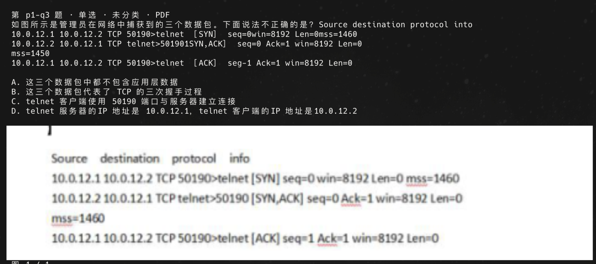

# PI-based-answering-framework

[](https://github.com/arvinhanye/PI-based-answering-framework/actions/workflows/ci.yml)

在终端里刷华为 ICT 网络赛道题库的小工具，基于 [Pi](https://pi.dev) 运行。

- **打字就作答**：输入 `B`、`AC`、`对` 回车，立即判对错并显示答案和解析。
- **不会就直接问**：打字提问即可，DeepSeek 会结合当前题目讲解，可以连续追问。
- **自动安排复习**：错题、没把握的题、问过 AI 才会的题，第二天会再出现。
- **题图直接显示**：在 Warp、iTerm2、Ghostty 等终端里，题图显示在选项下方。



## 快速开始

需要 macOS、Node.js 24 或更新版本、Git，以及一个 DeepSeek API key（用于 AI 讲解，不配置也能刷题）。

```sh
npm install -g --ignore-scripts @earendil-works/pi-coding-agent@0.87.1
git clone https://github.com/arvinhanye/PI-based-answering-framework.git
cd PI-based-answering-framework/pi-study
npm ci
npm run build
cd ..
pi install --local ./pi-study
```

**题库不在仓库里**，需要向组长要题库数据包，导入方法见 [用户手册 · 导入题库](docs/user-guide.md#3-导入题库)。导入后在仓库目录运行 `pi`，输入 `/study` 即可开始。

完整的安装、使用和常见问题，请看 **[用户手册](docs/user-guide.md)**。

## 当前状态

| 功能 | 状态 |
| --- | --- |
| 单选、多选、判断、填空快刷；撤销；错题与复习；跨会话恢复 | 可用 |
| DeepSeek 讲解与追问；题图发给 AI；每月费用记账（默认 10 元） | 可用 |
| 三份题库：1500 题、省赛 109 题、WLAN PDF 979 题，共 2596 题 | 可用（通过数据包导入） |
| 进度与成绩页（`/study stats`） | 可用 |
| 考点标签、按考点刷题、测验模式、联网查证 | 开发中，见 [后续计划](docs/superpowers/plans/2026-10-23-pi-study-roadmap.md) |
| Windows、Linux | 未验证，可以尝试，但不保证可用 |

## 目录

| 路径 | 内容 |
| --- | --- |
| [docs/user-guide.md](docs/user-guide.md) | 组员用户手册 |
| [pi-study/](pi-study/) | 程序源码；[pi-study/README.md](pi-study/README.md) 是开发与维护说明（转换、导入、CLI、数据目录） |
| [docs/superpowers/](docs/superpowers/) | 设计、审查与开发计划 |
| [pi-study/docs/acceptance/](pi-study/docs/acceptance/) | 验收记录 |

原始题库文件、转换后的题库、个人作答记录和 API key 都只保存在本地，不会进入 Git 仓库。
