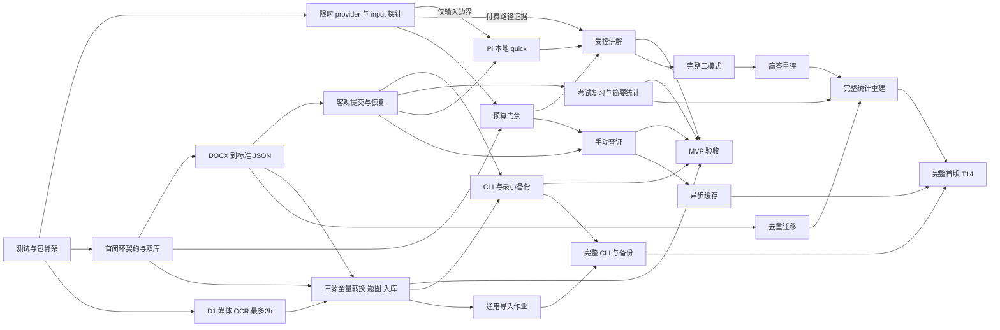

# Pi Study Implementation Plan

> **For agentic workers:** REQUIRED SUB-SKILL: Use superpowers:subagent-driven-development (recommended) or superpowers:executing-plans to implement this plan task-by-task. Steps use checkbox (`- [ ]`) syntax for tracking.

**Goal:** 获准开发后 72 小时内交付三份资料均已转换并实际导入的备考小版本，再完成可更换题库、三种学习模式、追溯判分和本地预算硬准入的完整首版。

**Architecture:** 应用轨先以第一份 DOCX 小样本打通标准 JSON → 本地客观刷题 → 恢复／复习／备份，并接入通过费用验证的模型讲解与手动查证；资料轨并行完成两份 DOCX 与 235 页 PDF 的全量转换、题图关联、页级处理记录及实际入库。业务核心与 Pi／CLI 分离，业务与财务 SQLite 分离；通用导入管理、迁移、简答与完整统计后续补齐，不在首次刷题前冻结全部契约。

**Tech Stack:** TypeScript ESM、Node >=24、`node:sqlite`、Pi SDK peer dependency（本机 0.87.1 验证基线）、Vitest；ZIP/XML/PDF 依赖固定版本与锁文件；D1 限时验证 macOS Vision／PDFKit。

**Spec:** [Pi Study 设计方案](../specs/2026-10-23-pi-study-design.md)。实施时同时阅读；[审查意见](../reviews/2026-10-23-pi-study-review.md)作为问题来源，不把其中未核实的技术建议当成事实；取舍依据见[审查处理记录](../reviews/2026-10-23-pi-study-review-resolution.md)。

**执行状态（2026-10-23）：** 用户已确认开发，并另行授权 Git 管理。以下约束和任务清单保留审批时内容；实现证据、当前可用范围和剩余门禁见[验收清单](../../../pi-study/docs/acceptance/checklist.md)。原“尚未开发”和“不初始化 Git”不再代表当前状态；未获得自动公开发布授权。

## Global Constraints

- 当前只修订设计与计划；**尚未开发、运行测试、安装或付费调用**。用户确认开发后起算 72 小时，先交小版本，再交完整首版，后续功能没有取消。比赛仅明确“13 号”；按今天 2026-10-23 临时规划为 **2026-11-13，月份与年份待核准**，不是已确认日期。
- 最新范围纠正：**三份题库均须在 MVP 完成转换并实际导入**，包括省赛 DOCX 和 PDF 全 235 页；不能只交第一库或把原页附件算成结构化转换。原件缺图／缺答案的可辨识候选可入库为 `needs_review` 并禁止评分；OCR 未识别区域必须单列转换缺口，未解决时 MVP 未完成。
- 未来源码位于 `pi-study/`；现有三份资料只读。当前不是既有代码仓库；不自动初始化 Git、提交、推送或公开发布。
- 当前 macOS 是实际验收平台；核心可移植，Windows／Linux 未验收前不宣称支持。不增加网页、账号、云同步、MCP 服务端或自动出题实现。
- 所有成绩称“参考成绩”；结构状态与依据状态分开。`source_only` 可练习，实质缺条件返回 `unscorable`，不制造薄弱点。出题视图不含答案、解析或含答案整页。
- 只有真实用户边界的明确操作可提交、揭晓、跳过、交卷、改额或恢复。模型工具不注册这些写方法；审计来源不是认证令牌。核心仍检查会话、当前展示、题目版本、状态与幂等键。
- Pi `input` 在模型之前运行，可返回 `handled`；只有 `source=interactive` 可作为此边界的人类输入，`rpc`、`extension` 不自动可信。异常要显式 `handled` 并显示错误，不能靠抛错阻断。其他扩展可先 transform 输入；学习会话须检测冲突并拒绝含糊提交。
- Pi slash 命令执行早于 `input`，扩展 `sendUserMessage(..., expandPromptTemplates:true)` 也可能触发 slash；命令本身不能证明真人。无法区分来源的 slash 仅打开交互界面，不计分；写动作退到可确认真实交互的 TUI／菜单 handler 或独立 CLI。Pi 无法证明输入边界时，相关 Pi 写入口禁用并明确报告，CLI 仍交付。
- 每自然月默认 **10 CNY**，跨题库、Pi 会话、CLI 共用；机器 IANA 时区初始化保存，修改下一周期生效。金额整数纳元（1 CNY = 1,000,000,000 纳元），对外十进制 string，内部 BigInt。
- 准入条件是 `已结算 + 未结清预留 + 本次上界 <= 月限额`。状态 `reserved → dispatched → settled / released / unknown`；先持久化 dispatched 再发送。确认发送前取消可 released；不确定是否计费保留占额；重试每次独立准入；跨月归发起周期。
- 首个模型按官方 `deepseek-flash` 验证；未知／过期价格或无法证明费用上界拒绝发送。快刷输出上限初始 1024、精学／简答 4096 tokens；推理必须纳入服务端可执行计费输出上限。所有默认项与允许钩子完成后的最终 payload 才计算上界，预留后禁止改收费参数。
- 上界策略按证据选择 `validated-tokenizer / verified-byte-bound / full-context`；字节上界需目标 tokenizer、消息模板、工具与图片计费的证明，不因通用 BPE 假设替代完整上下文保守 fallback。三种策略均无法证明则拒绝。
- 首选复用经核实的 Pi provider 适配器，在自有最终 `fetch` transport 做预算门禁，显式内外重试为 0；用户／会话重试每次重新准入。只有最终 payload 或辅助请求无法控制时才自写 HTTP／SSE，不预先制造一套流协议实现。
- 业务库与财务库分别启用 WAL、外键与 `busy_timeout=5000ms`（可配置）；短写事务使用 `BEGIN IMMEDIATE`，不得在事务中等待网络、模型或用户。预算路径不随业务空间变更，业务恢复不得覆盖财务库；账本缺失／冲突冻结付费请求。
- Search、Fetch 均调用 DeepSeek 服务端 API；本地仅访问固定服务商 endpoint，不直接连接目标网页。不安排本地 DNS rebinding／逐跳重定向抓取实现；仍验证 endpoint、用户 URL 基本格式和网页提示注入不能修改规则／预算。
- 本地识别优先；批量云识别必须预览范围、路线、费用上界和余额并确认，确认不越过预算。不静默安装系统工具，不把凭证写入业务库、日志、快照或备份。
- T00 是骨架，T01／T02 是限时能力调查；不伪造探针红灯。实现任务先写有意义的行为测试、确认失败原因、实现并验证；测试未发现／路径不存在不算红灯。自动测试、mock、人工题库真值、真实 Pi／服务观察分别报告。

## Review Focus

1. 两进程争用最后余额、锁超时、发送交界崩溃：仅合法预留发送，unknown 不释放；T03／T04。
2. 单段 XML 内换行丢失、选项续行被误切、题图缺失：保留结构并给候选去向；T05／T06A。
3. extension／rpc／slash 伪装用户、输入被 transform、旧展示迟到：拒绝含糊写入，异常显式 handled，核心校验与幂等；T01／T08／T09A。
4. 改题号／改选项／改答案／实质改题：版本映射不同，原分保留，不自动迁移熟练度；T07／T12B。
5. 备份越界、恢复中断、旧财务账本混入：不写出目标空间、不回滚费用；T13A／T13B。

---

## 阶段、工期与交付口径

三天目标因“三份均须转换导入”而扩大，需**应用轨与资料轨并行**。下表是工程估算与排程目标，不是已经验收或技术必然可行的承诺；从用户明确确认开发起计时。MVP 约 **41–62 个有效工程小时**：原应用／AI／恢复轨 27–40h，加前移并扩大后的媒体／三源转换／校对轨 14–22h；分布在 72 小时窗口，不假设用户连续值守。D1 用真实页样本测量 OCR 吞吐与错误率，区分工程工时和机器批处理耗时，每日重估；不得为赶期限降低识别验收、输入或预算边界。

| 时间／阶段 | 并行范围与估算 | 可检查成果与门禁 |
| --- | --- | --- |
| D1：0–24h | 应用轨：T00、T01、T03、T05 小样本、T08、T13A CLI，约 11–15h。资料轨：T02 最多 2h（估算 1–2h），T06A 三源样本／转换／题图实现 3–4h。合计约 15–21h。 | **首次可刷目标第 10–16 小时**：固定样本 CLI 明确提交／恢复。另交三源样本结果、PDF 吞吐／失败预估与全量处理计划；媒体调查不阻断首次小样本刷题，但三源转换是 MVP 退出门禁。 |
| D2：24–48h | 应用轨：T04、T09A、T11A、T12A、T05 扩大，约 11–17h。资料轨：T06A 省赛／PDF 全量批处理、题图、页级 checkpoint、三源 JSON 实际导入，6–9h。合计约 17–26h。 | Pi quick、考试复习与统计；**首次受控 AI 目标第 24–48 小时**。三份均产转换／入库报告，PDF 235 页逐页有处理状态，未识别区域排入补漏。D2 明确 AI 和资料两条轨的阻断，不把仅完成部分页面称为全量成功。 |
| D3：48–72h | 应用轨：T05 核对、T13A 备份、T14 安装／验收／修复，约 4.5–7h；资料轨：三源补漏、人工真值、图片检查、按来源抽题验收，4–7h。合计约 8.5–14h；总计约 41–62h。 | 第一份 1508 候选全部有去向，省赛题数按解析核定，PDF 全 235 页处理且可辨识候选实际入库；每源可抽题并追溯题图／定位。备份恢复覆盖三源。若 OCR／预算／输入或 AI 仍失败，交可用部分并明确**MVP 未完成及缺口**，不自行退回“只第一库”的范围。 |
| 完整首版：MVP 后 | T06B 通用导入作业 4–6h；T07 5–8h；T09B／T10 10–16h；T11B／T12B 6–10h；T13B／T14 8–12h；共 **33–52h**，暂估额外 **5–8 个工作日**。 | 补通用导入管理、迁移、简答、完整三模式、异步缓存、完整统计与增强备份；三源转换／媒体工时已前移到 MVP，不重复计算。每日重估，不能据此保证待核准比赛日期前全部验收。 |

**MVP 功能边界：** 三份资料专项转换与标准 JSON 导入、来源定位、题图和最小页级 checkpoint；第一份 DOCX 的 1508 候选全部归因，省赛全文处理，PDF 全 235 页处理，所有可辨识候选入库并可按来源筛选抽题。保留四类客观题 CLI／Pi quick、明确提交、草稿／恢复、错题、独立／辅助简要统计、考试感知复习、三源最小备份，以及硬门禁后的 AI 讲解和手动查证。原材料确实缺图／缺答案的候选入库 `needs_review`，不可评分；OCR 失败仅保留原页／附件不算转换完成。每源报告 hash、页／段覆盖、候选数、ready、待处理、无法识别区域及样本正确率，所有遗漏须显式可定位。PDF 10 页／20 题是质量抽样门槛，**绝不替代全 235 页转换和导入**。完整首版继续覆盖 R01–R18。

## 执行约定与文件所有权

所有文件待创建，命令默认在未来 `pi-study/` 执行。T00 配置 `npm test=vitest run`、`npm run typecheck=tsc --noEmit`、`npm run build=tsc -p tsconfig.build.json`；构建编译 src 到 dist，包括 `src/import/converters/` 的转换实现。顶层 `converters/*.mjs` 仅作可直接运行的参数入口，调用已构建模块，不要求用户运行未编译 TypeScript。每个实现任务通过指定测试后执行类型检查；共享文件由集成者顺序合并，避免代理同时修改。契约按切片扩展，同义类型不重复创建。

| 文件／目录 | 所有者、阶段与职责 |
| --- | --- |
| `package.json`、锁文件、`tsconfig*.json`、`vitest.config.ts` | T00 骨架；T14 打包。后续依赖由集成者统一更新。 |
| `src/contracts.ts`、`src/contracts.schema.ts`、`schema/` | T03 首闭环；各任务仅增本切片 DTO／schema，由集成者维护兼容性。 |
| `src/storage/{business,finance,migrations,paths}.ts`、`src/composition.ts` | T03：双库、短事务、路径与装配；后续迁移按版本追加。 |
| `src/banks/{service,topics}.ts` | T03 基本题库；T05 标签；T07 多源策略。 |
| `converters/{first-docx,province-docx,pdf}.mjs`、`src/import/converters/{first-docx,province-docx,pdf}.ts`、`src/import/{json,validation,assets}.ts` | T05 第一来源转换／JSON；T06A MVP 省赛和全 PDF；顶层 mjs 调用 dist 内实现，转换输出标准 JSON，不绑定学习状态。 |
| `src/import/checkpoint.ts`、`src/import/{service,jobs}.ts` | T06A 仅负责 checkpoint.ts 的最小页级恢复；service/jobs 由 T06B 后补通用作业管理，复用 converter。 |
| `src/budget/{service,ledger,pricing,gateway,transport}.ts` | T04：唯一付费出口和最终 payload 预算准入。 |
| `src/study/{service,user-action,objective,views,exam}.ts`、`src/pending/service.ts` | T08 状态／判分／审计；T09B 测验。无令牌签发层。 |
| `src/adapters/pi/{index,provider,input,session,ui}.ts` | T09A 最小 Pi／受控模型；T09B 完整交互。 |
| `src/cli/{index,commands}.ts`、`src/backup/{service,manifest,archive}.ts` | T13A CLI／最小安全备份；T13B 全命令与完整资料恢复。 |
| `src/questions/{versions,deduplicate,upgrade}.ts` | T07 完整首版去重与升级。 |
| `src/grading/{service,rubrics,regrade}.ts` | T08 客观接口；T10 简答、申诉与重评。 |
| `src/evidence/{service,policy,transport,cache}.ts` | T11A 手动服务端查证；T11B 异步／缓存。 |
| `src/review/{scheduler,statistics,rebuild}.ts` | T12A 考试感知与简要统计；T12B 完整统计／重建。 |
| `native/{ocr.swift,render.swift}`、`probes/` | T01 provider／input 调查；T02 D1 并行限时媒体调查；T06A MVP 正式媒体／全量转换。 |
| `tests/{unit,integration,fixtures}`、`docs/{verification,acceptance}` | 各任务拥有对应测试／证据；T14 汇总，不用 mock 代替真实验收。 |

## 依赖图与阶段门

图中 Q 与受控讲解都是 T09A 的子步骤。T01 的付费证据／T04 不阻断本地 quick；Pi 计分入口仍须通过 T01 输入边界验证，CLI 则独立可用。T06A 的云补充路线另依赖 T04 与批次确认；本地转换不依赖云门禁。T02／T06A 是三源 MVP 的必要路径，但不阻断提前交给用户试用的小样本 CLI。T13A 的 CLI 子步骤随 T08 可先完成，三源完整备份子步骤须等 T06A。T10 另依赖 T04；T09B 的离线测验不依赖联网。MVP 与完整首版均使用 T14 的相应验收清单，不创建一套重复任务。

## T00 — 独立最小测试与包骨架

**Files:** `package.json`、`package-lock.json`、`tsconfig.json`、`tsconfig.build.json`、`vitest.config.ts`、`tests/unit/scaffold.test.ts`。

**Interfaces:** 提供上述三个 npm scripts 和可注入时钟／临时目录测试约定；不定义业务契约。

- [ ] 创建 ESM、Node >=24、Pi peer dependency 和 Vitest 骨架；默认 `private:true`、`license:UNLICENSED`。
- [ ] 用一个实际被发现的最小测试核对执行入口，执行 `npm test -- tests/unit/scaffold.test.ts`、`npm run typecheck`，预期成功。此处不以人为失败冒充功能 TDD。
- [ ] 记录 Node／npm／Pi 实际版本；此后 T01、T02 可独立运行，不再相互借用骨架。

## T01 — 限时 provider 与 Pi 输入边界调查（2 小时）

**Files:** `probes/{provider,input}.ts`、`docs/verification/{provider-boundary,input-boundary}.md`。

**Interfaces:** 消费 Pi 0.87.1 公开 provider／extension API；输出“路径→准入点→最终 payload→重试→上限→依据→通过／失败／未验证”报告；不提前设计全部业务 DTO。

- [ ] 复核当前基线：`openai-completions.js:192` 配置 `maxRetries:0`，`utils/provider-retry.js:75` 默认重试 0，适配器支持 `options.fetch`。记录实际文件／版本；不能据审查建议推断 SDK 必然隐藏重试。
- [ ] 用记录计数的假 fetch 验证可在真实发送前拒绝、拿到默认项／钩子完成后的 payload；检查普通生成、摘要、压缩、继续生成、会话重试、模型切换和 fallback。内外重试显式 0；逐次会话重试必须回到准入。
- [ ] 验证 interactive／rpc／extension、其他扩展 transform、slash 先于 input、扩展触发 slash、异常返回 handled 的实际顺序。输出可靠写入口列表；不能确认来源的 slash 禁止计分。输入冲突不能默认为“真实用户”。
- [ ] 核对官方输入模板、tokenizer、工具、图像、推理输出、固定服务费与失败计费约定；将上界策略标为已证实或待证实。不用“UTF-8 字节数天然足够”的推测放行。
- [ ] 2 小时到点提交结论与最小下一步：优先复用适配器＋自有最终 fetch；无法控制才评估自写 HTTP／SSE。缺失证据禁用相应付费／输入路径，继续离线建设。后续 T04／T09 写正式回归测试；探针调查不要求人为红灯，也不等同真实服务验收。

## T02 — D1 并行媒体／OCR 验证（最多 2 小时，MVP 资料轨）

**Files:** `probes/media.ts`、`native/{ocr.swift,render.swift}`、`tests/fixtures/media/`、`docs/verification/media-capabilities.md`。

**Interfaces:** `runMediaProbe():Promise<void>`；输入省赛 DOCX 内嵌图与 PDF 首／中／末页、抓包字图和跨页样本，输出引擎／坐标／文本质量／吞吐／终端显示及全 235 页处理路线报告。

- [ ] 在 T00 后与应用轨并行，最多 2h 验证 Vision 中文／英文／命令／抓包小字和 PDFKit 渲染；记录依赖路径，不依赖 Codex 缓存或静默安装工具。
- [ ] 人工观察题图内联或明确本地打开，核对图文坐标与安全裁剪；无引擎给可执行下一步，纯占位或原页附件不算结构化题图／题目转换成功。
- [ ] 到点报告样本错误、每页耗时和全量批处理估算，给 T06A 可实施路线。若本地质量不足，列人工补录／可选云批次的范围、上界和预算条件；未获批次确认不得上传。能力未闭合明确标记三源 MVP 风险，继续不受影响的任务，不自动把 PDF 移出 MVP。

## T03 — 首闭环契约与双 SQLite

**Files:** `src/contracts.ts`、`src/contracts.schema.ts`、`schema/question-bank-v1.schema.json`、`src/storage/{business,finance,migrations,paths}.ts`、`src/banks/service.ts`、`src/composition.ts`、`tests/unit/contracts.test.ts`、`tests/integration/storage.test.ts`。

**Interfaces:** 仅固定下列 MVP 类型／服务；ID 为 string，时间 ISO UTC，金额纳元 string。后续任务在自己的切片添加 DTO、schema 和迁移，**不在此冻结简答、证据作业、升级与完整备份全部字段**。

| 首闭环契约 | 最小约定 |
| --- | --- |
| 来源／题目 | `Bank`、`SourceVersion`、`Question`、`QuestionRevision`、`SourceLocation`、`Asset`、`AnswerKeyVersion`；保存内容 hash、原文、原答案、结构状态／依据状态、稳定 ID 与不可变版本引用。MVP 定义段落／页码／边界框来源定位及 `Asset{id,path,hash,mediaType,sourceLocation}`，题图必须关联题目版本；页处理记录随 T06A 增量添加，不预建未来全部 DTO。 |
| 展示／作答 | `StudySession`、`Presentation`、`Submission`、`GradeRevision`；`QuestionView{questionRevisionId,presentationId,type,prompt,options,assets,confidenceRequired}` 严格白名单无答案。 |
| 提交／审计 | `SubmissionInput{sessionId,presentationId,questionRevisionId,answer,confidence,idempotencyKey}`；`UserActionContext{origin,eventId}` 只由真实 handler 产生用于审计，不是身份令牌，不由模型参数反序列化后冒充来源。 |
| 学习接口 | `StudyService.start(input:StartSessionInput):Promise<SessionView>`、`next(sessionId:string):Promise<QuestionView>`、`inspect(sessionId:string):Promise<SessionSnapshot>`、`resume(sessionId:string,action:UserActionContext):Promise<SessionSnapshot>`、`submit(input:SubmissionInput,action:UserActionContext):Promise<SubmissionReceipt>`、`feedback(presentationId:string):Promise<FeedbackView>`。 |
| 本地命令 | `StudyCommands.saveDraft(input:DraftInput,action:UserActionContext):Promise<SessionView>`、`hint(input:HintInput,action:UserActionContext):Promise<HintView>`、`skip(input:SkipInput,action:UserActionContext):Promise<SessionView>`；字段引用当前会话／展示／预期状态，核心验证后才写。 |
| 题库／导入 | `BankService.list/create/select`；`JsonImporter.import(input:JsonImportInput):Promise<ImportReport>`；报告每个候选的定位、可用／待处理／拒绝原因；标准 JSON 支持题型联合，简答可导入但评分能力在 T10。 |
| 存储 | `openBusinessStore(path:string):BusinessStore`、`openFinanceStore(userRoot:string):FinanceStore`；财务默认 `~/Library/Application Support/pi-study/finance.sqlite`，不接受业务目录覆盖。财务表／DTO 在 T04 增量添加。 |
| 错误 | 首批 `INVALID_INPUT / STALE_PRESENTATION / ALREADY_FINALIZED / UNSCORABLE / STORAGE_BUSY / STORAGE_CONFLICT`；各后续切片新增具体错误，保持一个枚举。 |

- [ ] 写 `question_view_rejects_answer`、`core_does_not_import_pi`、`invalid_submission_shape_rejected`，执行 `npm test -- tests/unit/contracts.test.ts`，确认功能未实现导致失败，再实现类型与运行时校验。
- [ ] 两库各设 WAL、外键、`busy_timeout=5000` 可配置；写入用 `BEGIN IMMEDIATE` 短事务，不在持锁期间 await 网络／模型。幂等唯一约束、schema version 与备份前迁移策略在此落地。
- [ ] 写并通过 `two_process_writes_preserve_all_rows`、`busy_timeout_returns_storage_busy`、`crash_rolls_back_partial_write`、`finance_path_ignores_space`；用子进程实际争锁，断言超时后状态可重试且没有半笔写入。执行 `npm test -- tests/integration/storage.test.ts`、类型检查和 `node:sqlite` 冒烟。
- [ ] 输出首闭环 schema 示例和装配入口；新增后续契约须附该切片测试，不要求未来实体一次性到齐。

## T04 — 本地预算硬准入与最终 fetch

**Files:** `src/budget/{service,ledger,pricing,gateway,transport}.ts`、`tests/unit/pricing.test.ts`、`tests/integration/{budget-ledger,paid-gateway}.test.ts`、`docs/verification/budget-faults.md`。

**Interfaces:** 本切片添加 `BudgetService.snapshot/reserve/dispatch/settle/markUnknown/release/setLimit`、`PaidGateway.execute(input:PaidRequest):Promise<PaidResult>`、`PriceService.upperBound(input:PaidRequest,rate:RateCard):CostUpperBound`。`CostUpperBound` 保存金额、策略及证明版本；预留保存请求 ID、周期、费率版本、上界与最终 payloadDigest；改额只接受真实 handler 的 `UserActionContext`。

- [ ] 先写 `last_balance_two_processes`（10 元、已占 9 元、两个各 1 元请求最多发一个）、`dispatch_durable_before_send`、`unknown_survives_restart`、`cross_month_original_period`、`clock_rollback_no_new_allowance`、`retry_reserves_again`、`missing_ledger_freezes`；运行 `npm test -- tests/integration/budget-ledger.test.ts`，确认行为失败。
- [ ] 实现短事务原子预留、持久化 dispatch、幂等结算与 unknown；取消／断流／缺 usage 不自动判免费。确认未计费才 release，重试使用独立 requestId；锁超时未获准不得发送。
- [ ] 在 T01 证实的适配器最终 fetch 中规范／冻结 endpoint、model、max_tokens、工具与图像等 payload，再计算上界／digest／预留；发送前复核 digest。内外重试设 0，摘要等辅助调用同网关。不可控才转自写 HTTP／SSE，并补流式完整性测试。
- [ ] 最终 fetch 使用 `redirect: "error"` 或等价不自动跟随策略；测试 `provider_307_308_never_followed`，确认初始调用外没有第二次 HTTP 发送，尤其不向其他端点转发凭证。重定向失败的费用按实际可证明状态结算，不能无条件释放预留。
- [ ] 测试 `validated_tokenizer_requires_version`、`byte_bound_requires_tokenizer_template_image_proof`、`unverified_byte_bound_uses_full_context`、`full_context_may_reject_with_positive_balance`、`no_proven_bound_rejected`、`reasoning_requires_hard_output_cap`、`post_reservation_mutation_rejected`、`sdk_retry_no_unreserved_send`。不能降低完整上下文 fallback 来换取“可用”。
- [ ] 加入降额、改时区下月生效、80% 提醒、费率未知／过期、真实入口改额、无密钥日志与辅助请求回归。执行定价／账本／网关三组测试和类型检查；报告 mock 证明范围，真实 usage／账单留 T14。

## T05 — 第一 DOCX 转换、标准 JSON 与全量候选归因

**Files:** `converters/first-docx.mjs`、`src/import/converters/first-docx.ts`、`src/import/{json,validation,assets}.ts`、`src/banks/topics.ts`、`tests/fixtures/import/`、`tests/integration/docx-json-import.test.ts`、`docs/{import-format,acceptance/first-docx-report}.md`。

**Interfaces:** `convertFirstDocx(input:SourceInput):Promise<ConversionResult>` 输出标准 JSON、来源 hash、定位与异常报告；`JsonImporter.import` 写入业务库。转换与入库分离；MVP 不先实现通用作业管理，T06A 并行复用标准 JSON 补省赛／PDF 与最小页级 checkpoint，T06B 后补通用作业。

- [ ] 实现编译后的模块与 mjs 参数入口，配置 `npm run convert:first -- /绝对路径/来源.docx --output /绝对路径/题库.json`；先执行 `npm run build`。同时提供 `node /安装路径/pi-study/converters/first-docx.mjs ...`，缺构建产物返回明确说明，不能静默进入开发环境专用加载器。
- [ ] 首要测试 `preserves_wbr_wtab_option_boundaries`、`merges_option_continuation_lines`、`command_dots_do_not_split_options`。当前复核：1499 道有选项题全部选项同段，但 XML 保留 **3813 个 w:br**，选项边界有换行，**66 题共 109 个选项内续行**；第 87 题有标签单独一行，第 57 题有命令参数续行，9 道填空为空选项。先保留 w:br／w:cr／w:tab，再按行首标签分段并合并续行，不能对丢结构字符串粗暴按 `A.`／`B.` 切开。
- [ ] 固定真实干扰样本：641 选项 C 的 `X.25`、838 选项 C 的 `RSTP.MSTP`、951 选项 D 的 `NCE-FabriC.` 和题内 `DHCP` 换行 `Relay`；额外 `B.` 和命令标签反例为**人工 fixture**，不伪称已在原件发现。先运行 `npm test -- tests/integration/docx-json-import.test.ts` 观察解析断言失败，再实现。
- [ ] 首批人工校对真实样本覆盖四种客观类型、选项续行、缺图和第 3 题解析矛盾；保存原答案，不擅改。423／586／1065 缺图进入带定位待处理。无字母／异常标签、缺解析及原件未出现的 XML 边界另用标注清楚的人工 fixture，不混入原题库质量分母。
- [ ] 从来源标签提取 212/1508＝14.06%（安全 125、无线 68、数通 19），剩余 1296 默认“未分类”；支持手动标签编辑。可选模型标注在预算和用户确认的批次内执行，不默认给全部未分类题付费贴标签。
- [ ] 小样本通过后扩大全量，按题边界审计 **545／554／400／9，共 1508**，不是对全文关键词计数；输出每候选去向、选项数／答案映射／缺图核查清单，不把已知计数硬编码成解析结果。当前选项共 5203，1099 道单／多选中 41 道不是四项（存在 2／3／5／6 项），不能把非四项直接判异常；原单／多选答案标签均在选项集中，只证明格式映射，不证明知识正确。重复导入以 hash／版本及幂等键避免重复，保留来源快照。
- [ ] 测试 `all_candidates_accounted_for`、`invalid_option_answer_not_ready`、`raw_answer_preserved`、`missing_topic_unclassified`、`repeat_import_idempotent`；复跑测试／类型检查。至少 60 题人工真值样本验收在 D3 完成；未全量人工校对不宣称准确率 100%。

## T06 — 三来源资料处理分 A／B 两阶段

**Files:** `converters/{province-docx,pdf}.mjs`、`src/import/converters/{province-docx,pdf}.ts`、`src/import/{service,jobs,checkpoint,assets,validation}.ts`、`native/{ocr.swift,render.swift}`、`tests/integration/{pdf-import,page-checkpoint,import-jobs,three-source-import}.test.ts`、`docs/verification/import-quality.md`。

**Interfaces:** T06A 添加 `convertProvinceDocx(input:SourceInput):Promise<ConversionResult>`、`convertPdf(input:SourceInput,ctx:PageConversionContext):Promise<ConversionResult>`，复用 T05 标准 JSON 和 `JsonImporter.import`。最小 `PageProcessingRecord{sourceVersionId,page,status,candidateIds,unrecognizedRegions,outputHash,error?}` 持久化页级进度；MVP 仅按源和页保存 checkpoint，不建设完整 Job 框架。转换报告按源给 hash、总页／段覆盖、候选、ready／needs_review、无法识别区域及样本结果，不用成功附件数代替题目数。T06B 才补通用 `Importer`／作业 DTO。

### T06A — MVP：三份全量转换、题图、实际导入与最小 checkpoint

- [ ] 写 `all_235_pages_have_processing_records`、`all_recognizable_candidates_imported`、`each_source_can_select_questions`、`ocr_failure_not_reported_as_converted`、`page_checkpoint_resume_no_duplicates`；运行三源／PDF 测试确认真实行为缺失，不以测试未发现当红灯。
- [ ] 实现省赛全文转换并提取内嵌图／定位；109 个答案段落仅为来源观察，题数按分题结果核定。实现 PDF 全 235 页本地文字提取优先、逐页渲染／OCR、跨页拼接与题图关联；候选数解析后报告，不能预编造总题数。
- [ ] 写并通过 `mixed_pdf_preserves_positions`、`cross_page_keeps_all_parts`、`inline_answer_not_presented`、`unsafe_crop_needs_review`；题图须安全裁剪或以明确本地打开方式展示可用区域，不能向出题视图传含答案整页。原件缺图／缺答案的可辨识题目以 `needs_review` 入库并保留原因；不能因不可评分就丢掉候选。
- [ ] 批处理每页持久化状态与结果 hash，支持中断后从已核对页恢复、同源重复运行不重复入库；跨页题保留来源页集合，不能只存一页。source hash 改变拒绝接续旧 checkpoint。无法识别区域保存原页定位与错误并标转换缺口；**只存附件不算转换成功**。
- [ ] 三份转换输出均通过标准 JSON 校验并实际写入同一题库的独立来源，实际引用图片／页面资源复制到受控数据空间，不能依赖转换临时目录；核对候选→库记录逐项映射，第一 DOCX 1508 全部归因，省赛／PDF 各页或段落全部有处理状态。报告禁止静默漏页／漏题；未识别区域未解决即明确 MVP 未完成，不宣称“已全部转换”。
- [ ] 本地不足时先按失败区域组织人工修订或云批次预览；云路径必须 T04 通过、真实确认范围／路线／上界／余额，仍受 10 元硬预算。拒绝／预算不足保留缺口，不自动改成只导入第一库，不放开未受控调用。
- [ ] D3 完成每源报告：hash、总页／段数、已处理与失败覆盖、候选数、ready／needs_review、无法识别区域、样本正确率和人工改正记录；至少第一 DOCX 60 题、省赛 20 题、PDF 10 页且 20 题人工真值，逐项报告文字／边界／选项／答案映射／图片正确数和分母。**抽样用于验证质量，全 235 页仍须处理与入库**；不得靠全隔离满足零错误。
- [ ] 执行 `npm test -- tests/integration/pdf-import.test.ts tests/integration/three-source-import.test.ts tests/integration/page-checkpoint.test.ts` 和类型检查；真实 Pi／CLI 分别按三种来源抽题、打开题图、确认定位与 ready／needs_review 行为，再恢复 checkpoint 演练。

### T06B — 完整首版：通用导入任务与模板扩展

- [ ] 在已有专项转换与页 checkpoint 上添加 `Importer.inspect/extract`、`ImportService.plan/run/pause/cancel`、`ImportContext`、`ExtractedBlock`、`ImportJob`；复用既有状态，补跨来源通用模板、范围规划、暂停／取消、任务列表与来源变更恢复，不重新实现三份转换。
- [ ] 为通用作业补 `cancel_preserves_completed_items`、`changed_source_stops_resume`、`generic_job_reuses_page_checkpoint`，通过 import-jobs 测试／类型检查。模型辅助整理仍走既有预算和批次确认。
- [ ] 只保留 `QuestionGenerator.generate(input:GenerateInput):AsyncIterable<QuestionCandidate>` 契约以供将来扩展，不提供实现或模型工具；完整首版不新增自动出题范围。

## T07 — 多来源去重、升级与历史迁移（完整首版）

**Files:** `src/questions/{versions,deduplicate,upgrade}.ts`、`tests/integration/source-upgrade.test.ts`、`docs/source-upgrade.md`。

**Interfaces:** 本切片添加 `QuestionVersionService.preview(input:UpgradeInput):Promise<UpgradePreview>`、`apply(input:UpgradeDecision,action:UserActionContext):Promise<UpgradeReceipt>`；决策含旧版本、预览 ID、映射、幂等键，映射区分 `format_only / grading_only / semantic_change`。

- [ ] 写严格一致合并保留多出处、同知识点不合并、答案冲突待确认、改号／选项映射、实质改题与删单一来源测试；执行 `npm test -- tests/integration/source-upgrade.test.ts` 确认失败。
- [ ] 实现严格指纹合并与人工预览；安全排版变更验证答案映射后继承；只改依据可确认后重评；实质条件／选项语义／题图变化保留历史但新版重练。
- [ ] 过期预览与并发更新拒绝覆盖；演练改号＋改答案＋实质改题＋删来源，查回原分；复跑测试与类型检查。

## T08 — 明确提交、客观判分与离线恢复

**Files:** `src/study/{service,user-action,objective,views}.ts`、`src/pending/service.ts`、`src/grading/service.ts`、`tests/unit/objective.test.ts`、`tests/integration/{submission,offline-loop}.test.ts`。

**Interfaces:** 实现 T03 学习／命令接口；`UserActionContext` 由 Pi／CLI 真实 handler 直接传入，core 不以 origin 字符串认证真人。`GradingService.grade(submissionId:string,ctx:GradeContext):Promise<GradeResult>` 返回 `scored / unscorable / disputed`、依据版本与参考分；此时 GradeContext 仅落实客观依据，T10 扩展简答字段。

- [ ] 写 `ambiguous_chat_does_not_submit`、`stale_session_presentation_revision_rejected`、`idempotent_retry_counts_once`、`same_key_different_payload_rejected`；运行客观／提交／离线三组测试确认状态断言失败。
- [ ] 实现短事务提交：校验活动会话、当前展示、题目版本、可提交状态，再用幂等唯一键写作答／判分／审计；`origin/eventId` 只记录入口。模型 JSON 无写入口，不建立凭据签发／消费机制。
- [ ] 实现草稿、确定性、提示／揭晓辅助标记、跳过、作废审计、只读状态与恢复。`next` 不覆盖未提交题，恢复原展示／草稿；反馈只能由状态开放，不接受 `allowReveal` 参数。
- [ ] 单选／判断规范匹配；多选默认全对，部分分仅用显式规则；填空仅显式等价／容差，保留命令大小写／单位语义。缺条件 unscorable，source_only 仍可参考计分。
- [ ] 通过 `question_view_has_no_answers`、`hint_marks_assisted`、`command_case_not_folded`、`feedback_locked_until_submit_or_reveal`、`restart_keeps_presentation`；复跑测试／类型检查，经 T13A CLI 演练导入→答题→重启→原分可查。

## T09 — Pi 交互分 A／B 两阶段

**Files:** `src/adapters/pi/{index,provider,input,session,ui}.ts`、`src/study/exam.ts`、`tests/integration/{pi-session,exam-mode}.test.ts`、`docs/pi-usage.md`。

**Interfaces:** 消费学习／预算服务；T09A 只注册已实现的只读学习查询和受控查证工具，T09B 补齐设计 §10.1 全部工具。提交／揭晓／跳过／交卷／改额不注册为模型工具。

### T09A — MVP：本地 quick 与受控讲解

- [ ] 写 `interactive_input_intercepted_before_model`、`rpc_extension_do_not_submit`、`extension_triggered_slash_cannot_score`、`transformed_ambiguous_input_rejected`、`handler_error_returns_handled`、`tools_exclude_privileged_writes`，运行 Pi 会话测试确认失败。
- [ ] 按 T01 证实的来源边界接入真实 input／TUI／菜单；专用学习会话做扩展冲突检测，无法证明原文时提示使用可验证菜单／CLI。slash 只作为入口时不得附带无条件可信提交。
- [ ] 实现题库选择、quick、提交、恢复和退出，以及预算查看／设置菜单；改额由实际用户交互调用同一 BudgetService。保存／恢复宿主模型与工具。先本地反馈，再允许受控模型依据所给解析解释；缺解析不编造依据。切换到未受控 provider 停止学习付费路线。
- [ ] 仅 T04 通过才开启 AI；预算耗尽／未通过时保留本地菜单与 CLI。运行 Pi 会话、T08、T04 回归；真实 Pi 观察输入拦截和退出恢复并记录，不能只凭 mock 宣称可用。

### T09B — 完整首版：精学与测验

- [ ] 添加测验 DTO 与 `finishExam(sessionId:string,action:UserActionContext):Promise<ExamReceipt>`；写固定 seed、草稿、到时冻结不自动交卷、交卷前反馈锁及替代工具不能泄题测试。
- [ ] 实现精学答案＋理由、提示与精学切换；测验交卷后可评分未答计零，冻结题目集合／分母／依据快照。补全 10 个工具及可见性投影，原服务对象不直接透传。
- [ ] 执行 Pi／测验两组测试与类型检查，实际走三模式及异常退出恢复。

## T10 — 简答、申诉与重评（完整首版）

**Files:** `src/grading/{service,rubrics,regrade}.ts`、`tests/integration/rubric-grading.test.ts`、`docs/grading.md`。

**Interfaces:** 本切片扩展 `GradeContext`，添加 `RubricVersion`、`Appeal`、`RegradeInput`；`RubricService.propose/confirm/appeal`、`GradingService.regrade`，确认／重评接收 `UserActionContext`。此时定义评分点及证据结构，不回填成 T03 前置设计。

- [ ] 写临时规则完整保存、关键词堆砌不满分、依据不足 unscorable、申诉重评保留原分、实质改题拒绝旧答重评测试；运行 `npm test -- tests/integration/rubric-grading.test.ts` 确认失败。
- [ ] 复用既有规则或经网关生成临时规则；保存逐点用户证据、缺漏、错误、分值和模型版本。结构无效／超时／预算不足可未评分，不编造数值。
- [ ] 用户确认产生确认版本；同一语义题可显式重评产生新 GradeRevision，保留原规则和分数；网页结论不触发自动改分。
- [ ] 使用标注清楚的标准 JSON 人工简答样本，原第一 DOCX 无简答；通过本组、T08 与类型检查，评分可追溯但不宣称与人工完全一致。

## T11 — 联网查证分 A／B 两阶段

**Files:** `src/evidence/{service,policy,transport,cache}.ts`、`tests/integration/evidence.test.ts`、`tests/unit/network-policy.test.ts`、`docs/evidence-policy.md`。

**Interfaces:** T11A 添加 `VerifyInput{questionRevisionId,submissionId?,intent,sourcePolicyId}`、最小来源策略与证据记录，实现 `EvidenceService.verify/inspect/read/cancel` 的手动任务路径；T11B 在同一接口扩展异步队列／缓存字段。查证绑定原题／作答，不读取回调到达时的“当前题”作为归属。MVP 的来源策略可通过每库配置设置，完整配置菜单后续补齐。

### T11A — MVP：用户手动查证最低闭环

- [ ] 写 `search_fetch_use_fixed_provider_endpoint`、`target_url_not_fetched_locally`、`invalid_url_rejected`、`web_instructions_cannot_change_budget_or_rules`、`result_never_regrades_implicitly`；运行证据／网络策略测试确认失败。
- [ ] 真实用户明确请求后，经 T04 调 DeepSeek 服务端 Search／Fetch；固定服务商 HTTPS endpoint，目标 URL 做协议／格式／凭证／明显本机地址基本校验，不能把网页指令转成新 endpoint、预算、规则或执行命令。此处不实现本地 DNS／逐跳重定向抓取。
- [ ] MVP 每次手动查证最多 1 Search／1 Fetch，30 秒等待目标可取消；模型／服务超过时限未完成显式显示。先展示本地参考判定；保存实际支撑段落的 URL／标题／时间／hash／位置／版本，摘要不能冒充原文。
- [ ] MVP 采用明确“手动查证→显示结果”，不先建设自动触发与后台缓存。答前请求标记辅助，测验反馈规则在 T09B 接入；复跑本组、T04 和类型检查。

### T11B — 完整首版：自动触发、异步与缓存

- [ ] 扩展已有 `EvidenceService` 与 `EvidenceJobView` 的后台执行／缓存状态，写 `cache_key_includes_version_intent_policy`、`force_keeps_old_evidence`、`late_result_stays_with_original_question`。
- [ ] 实现冲突／不足／版本疑问触发，每次默认最多 2 Search／3 Fetch，默认 30 天缓存、强制绕过缓存、取消／继续下一题与 incomplete 状态；旧证据保留，各学科策略独立，版本不符／失效／冲突明确显示。
- [ ] 复跑证据、可见性与预算测试；后台返回不静默改成绩，关联原作答可查询。

## T12 — 复习与统计分 A／B 两阶段

**Files:** `src/review/{scheduler,statistics,rebuild}.ts`、`tests/unit/review-scheduler.test.ts`、`tests/integration/statistics-regrade.test.ts`、`docs/statistics.md`。

**Interfaces:** T12A 添加 `ReviewService.queue(input:QueueInput):Promise<QuestionRevision[]>`、`StatisticsService.read(input:StatsQuery):Promise<StatisticsView>`；配置 `examDate?:string`（ISO 本地日期）与 IANA `timezone`，按日历日期计算剩余天数 D；待核准的 2026-11-13 不静默写入运行配置。T12B 添加 `rebuild(questionId:string):Promise<ReviewState>`。

### T12A — MVP：考试感知、错题与简要统计

- [ ] 写 `no_exam_preserves_1_3_7_14_30`、`exam_d_ge_2_caps_at_half_days`、`last_day_uses_today_sprint_once_per_session`、`fourteen_day_mix_is_nine_to_one`、`explicit_filter_wins`、`expired_exam_requires_update_or_normal_mode`；运行 scheduler 测试确认失败。
- [ ] 无 examDate 保持 1／3／7／14／30 天，错题／提示后答对／不确定答对次日。日期有值且 D>=2：`interval=min(baseInterval,max(1,floor(D/2)))`；D=0 或 1 时不推到考后，放今日冲刺队列，每题每会话最多一次，避免答完立刻循环；D<0 提示更新并回普通调度。日期规则最后应用于错题／辅助答对的次日安排，避免考前一天仍推到考后。
- [ ] 考前 14 天内“到期／错题:新题”目标 9:1，其余默认 4:1；仅有对应余题才混排，显式错题／来源／知识点等筛选优先。过期日期提示更新并切回普通模式，不无限维持考前冲刺；日期／时区在设置页可见，临时 2026-11-13 标待核准。
- [ ] 输出覆盖、错题、到期、当前客观参考正确率与历史次数；独立／辅助分开，未答／跳过／作废／不可评分不进日常分母，争议暂停汇总。测试“先错后对历史 1/2、当前 1/1”、辅助不覆盖独立与 unscorable 不制造弱项，执行两组测试／类型检查。

### T12B — 完整首版：三模式统计与重评重建

- [ ] 添加简答独立得分之和／满分之和及辅助组；80% 达标，临时规则间隔最多 7 天；测验快照可评分未答零分、排除项明确，重评生成新分母快照。
- [ ] 接入 T07 语义版本／去重与 T10 重评事件，重建仅受影响题目；测试 `rebuild_replays_identically`、`merged_sources_count_once`、`semantic_change_resets_coverage`、`exam_regrade_preserves_snapshot`。
- [ ] 复跑 scheduler、统计、T07／T10 与类型检查；统计均给分子／分母／排除规则，不把 source_only 暗示为权威核验。

## T13 — CLI 与备份分 A／B 两阶段

**Files:** `src/cli/{index,commands}.ts`、`src/backup/{service,manifest,archive}.ts`、`schema/backup-manifest-v1.schema.json`、`tests/integration/{cli,backup-restore}.test.ts`、`docs/backup-restore.md`。

**Interfaces:** CLI 只调用同一服务；T13A 定义 `BackupService.create/inspect/restore`，restore 仅接受真实 handler 的 `UserActionContext`。manifest 含 schema／业务版本、文件 hash／大小，绝不包含可恢复财务库。

### T13A — MVP：CLI 与最小安全手动备份

- [ ] 随 T08 实现 `study bank list/create/select`、`study import/start/answer/resume`，随 T12A 补 `study stats/review`，随 T04 补 `study budget show/set`；真实 CLI handler 创建审计来源，输出路径不复制业务规则。验证 `pi_cli_share_budget_and_settings`，MVP 即可从 Pi 与终端调整同一月限额。
- [ ] 写 `cli_works_without_credentials`、`restore_finance_unchanged`、`restore_failure_keeps_old_space`、`rejects_traversal_symlink_corrupt_archive`；执行 CLI／备份测试确认失败。
- [ ] 最小备份包含 SQLite 一致性快照、三源 JSON／原件快照、题图、题目与页／段／边界框定位、页级处理记录、当前实际使用的策略／证据与校验 manifest；排除密钥和 finance.sqlite，可附只读预算报告。MVP 即限制包体／展开量／条数并校验路径，不推迟恢复安全边界。
- [ ] 恢复先检查版本／hash／路径／容量并预览，用户确认后写新空间、校验、原子切换；失败保持旧空间。完成备份→新空间恢复→三源分别抽题／查题图及页记录→原分查询→财务未变演练；复跑测试／类型检查。提供 `node /绝对路径/pi-study/dist/cli/index.js` 可执行后备入口。

### T13B — 完整首版：全命令与完整资料恢复

- [ ] 补题库来源策略、标签、导入作业、待处理确认、升级迁移、评分规则、重评、完整统计和预算分项／对账视图；Pi／CLI 设置共用，提额不暴露模型工具。
- [ ] 在 MVP 已含三源图片／定位／页记录的基础上扩充完整评分规则、异步证据／缓存和通用作业状态；源文件被移动仍可历史追溯。默认源文件 512 MiB；导入 ZIP 展开 1 GiB／单项 256 MiB／10 万条，备份展开 4 GiB／单项 1 GiB／10 万条，可本地配置并明确报错。
- [ ] 通过 ZIP bomb、真实资源恢复、迁移前备份、账本缺失冻结与 T04 故障回归，演练恢复后原分／图片／策略均正确。

## T14 — 两阶段本地打包与实际验收

**Files:** `package.json`、`README.md`、`docs/acceptance/{checklist,source-report,provider-billing}.md`、`tests/integration/package-smoke.test.ts`。

**Interfaces:** 无新业务接口；组合已实现切片，不以完整首版的后续功能阻断 D3 离线小版。安装包白名单包含实际运行需要的 dist、`converters/*.mjs`、schema、说明与原生 helper，排除原题库、来源快照、数据库、财务、密钥和临时数据。

- [ ] 写 `pack_excludes_user_data`、`missing_credentials_keeps_local_features`、`installed_cli_pi_entries_resolve`；实现 package files／bin／Pi 元信息，执行 `npm run typecheck`、`npm test`、`npm run build`、`npm pack --dry-run`、`npm pack` 并检查清单。
- [ ] 用 `pi install --local /绝对路径/pi-study` 实际加载；保留源目录，不 npm publish。验证 CLI PATH 或 README 的直接 Node 入口，不把 Pi 加载当 CLI 安装成功。
- [ ] 加入 `installed_three_converters_produce_valid_json`：在临时目录解包安装产物，逐一调用第一 DOCX、省赛 DOCX、PDF 三个包内 mjs 入口，转换明确标注的独立人工 fixture（PDF 含扫描页／题图），校验标准 JSON、图像和处理报告并实际导入；不能依赖源码工作目录或未打包的 TS 文件。README 给出构建→转换→导入→Pi／CLI 刷题的完整命令顺序。
- [ ] **D3 MVP 清单：** 三源 hash／全文覆盖／候选／入库去向报告；第一 DOCX 1508、省赛按实际分题、PDF 全 235 页及实际候选数；人工真值至少 60／20／PDF 10 页且 20 题。三源在 Pi／CLI 按来源实际抽题、题图／定位、明确提交／恢复、错题／统计、考试日期及三源备份恢复；受控讲解和手动查证仍须验收。OCR 只留附件／仍有未识别区域、某来源未实际导入、输入或预算未通过，均列明确缺口并标 **MVP 未完成**；可交付可用部分但不能自行缩减范围。
- [ ] **完整首版清单：** 在已完成三源导入／图片验收上追加通用导入任务、五题型、三模式、异步证据、迁移重评、完整统计／增强备份；回归三源、实际跨页与抓包图，不把它们再列成首次交付。不存在的边界只用明确人工 fixture；报告自动可用比例，不许全部隔离虚过。
- [ ] 获准开发、凭证配置且预算门禁通过后，在 10 元月限额内做小额真实模型／辅助调用／Search／Fetch 联调，核对 usage 与可获得账单；常规限定联调不逐次重新确认，批量云识别另确认。未能证明的路线继续禁用。
- [ ] 分别出具 MVP／完整首版状态、实际测试／手动观察／未验证项，检查最终差异；只有完整首版必需项全部通过才称完整首版完成。

## 需求覆盖矩阵

| 需求 | MVP 切片 | 完整首版补齐与证据 |
| --- | --- | --- |
| R01 跨学科／生成接口预留 | T03／T05／T06A 标准 JSON 与三源专项转换 | T06B 通用模板／生成契约、T11B 来源策略；不实现生成入口 |
| R02 核心与宿主分离 | T03／T08／T09A／T13A | 全阶段核心无 Pi import，MCP 不实现 |
| R03 五题型 | T05／T08 四类客观；JSON 可容纳简答 | T10 人工简答 fixture 与评分点 |
| R04 本地多库多源 | T03／T05／T06A／T13A 三源实际入库、可按来源抽题 | T07 多源关联与策略 |
| R05 明确提交／辅助区分 | T01／T08／T09A 来源边界、状态、幂等 | T09B 测验交卷边界 |
| R06 三模式 | T09A quick | T09B 精学／测验、T14 真实验收 |
| R07 选题与筛选 | T12A 考试感知、顺序／随机／错题／来源／标签 | T12B 完整模式与重建 |
| R08 参考成绩／无核验门槛 | T08／T12A source_only 与分母 | T10／T12B 简答与完整统计 |
| R09 不足可查证／不评分 | T05／T06A／T08／T11A 缺图候选入库待处理、手动查证；OCR失败单列缺口 | T11B 自动触发 |
| R10 简答版本／申诉／重评 | 保留基础版本不前置实现 | T10／T12B 全部功能与原分保留 |
| R11 本地提取／受控云补充 | T02／T04／T05／T06A 三源全量转换、媒体/OCR与批次确认 | T06B 通用导入任务复用同一网关 |
| R12 多来源去重 | 稳定 ID／hash | T07 严格合并与冲突决策 |
| R13 恢复／备份／升级迁移 | T06A 页级 checkpoint、T08 会话、T13A 三源备份 | T06B 通用作业、T07 迁移、T13B 增强备份 |
| R14 来源版本与证据缓存 | T05／T06A 三源版本、T11A 证据记录 | T11B 30 天缓存／强制刷新保留旧证据 |
| R15 先判分后查证 | T09A／T11A 手动最低闭环 | T11B 异步归属／取消／继续，无静默改分 |
| R16 10 元共享可调预算 | T03／T04／T09A／T13A 用户级财务库 | T13B 完整配置界面，所有调用共用 |
| R17 受控学习通道 | T01／T04／T06A云补充／T09A／T11A，T14真实计费 | T06B／T09B／T10 新增调用继续覆盖 |
| R18 当前 macOS 实际验收 | T02／T06A／T14 三源、图片／OCR、终端／CLI／Pi | T14 完整功能回归记录 |

## 交付、签收与文档自查

- [ ] MVP 交付本地包、CLI、三种专项转换器、三源标准 JSON 与实际导入库、题图／定位／页处理记录、每源全量覆盖和候选／样本报告、三源恢复说明、预算状态和已知缺口；比赛日期显式标记待核准。
- [ ] 完整首版追加通用导入作业、五题型三模式、迁移重评、完整缓存统计与增强备份，R01–R18 全部有验收证据。
- [ ] 证据分自动行为、mock 故障、人工真值、真实 Pi／服务四类；记录版本、日期、样本／操作与结论，未测项不勾完成。
- [ ] 人工演练缺凭证、预算耗尽、断流、重启、源文件移动、恢复；离线路径仍可用，未知费用不倒退。真实体验与未关闭限制由用户签收。

**文档自查记录：** 已按“三份均须转换导入”的三天 MVP 纠正检查应用／资料双轨、T02→T06A→MVP 门禁、A／B 阶段、文件所有权与 R01–R18。首次小样本 CLI 不等 OCR，但完整 MVP 必须完成三源全量处理和实际导入；原件缺材料待处理与 OCR 转换失败分开，抽样质量验收不替代 PDF 全 235 页覆盖。完整迁移、简答与通用作业仍后续补齐，不冻结全部 DTO。预算硬准入保持，输入审计不冒充认证，provider／选项结构／服务端 Fetch 的审查建议按复核证据修正。当前只完成文档修订，尚未执行开发、测试、安装、Git 或付费操作；下一步由用户审阅设计与计划后确认开发。
