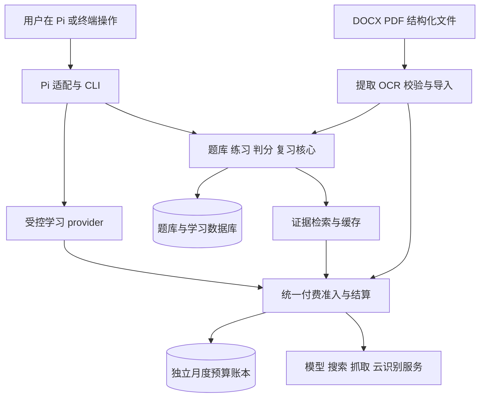

# Pi Study 可复用学习框架设计方案

> **当前状态（2026-10-23）：** 本文部分条款已被[交互改造规格](../specs/2026-10-23-pi-study-ux-redesign.md)、[后续开发计划](../plans/2026-10-23-pi-study-roadmap.md)取代。作废内容包括预算硬控制（R17 / 原设计 §9 预留状态机）、一次性提交凭据与确认框（R05 / 原设计 §6）、原设计 §10.1 的 10 个模型工具。后续计划 §6 已将简答评分/规则版本/申诉重评、精学、资料升级迁移、通用导入/模板/云端 OCR 批次、证据缓存/异步查证、MCP 适配与自动出题移出完整首版范围；不再视为本版未完成项。原文保留作历史记录，当前范围以新规格和后续计划为准。

状态：用户已确认并进入开发；本文保留已确认设计，实际交付与未完成项以[验收清单](../../../pi-study/docs/acceptance/checklist.md)为准。日期：2026-10-23。本文区分 3 天 MVP 与完整首版。审查逐条处理见[修订记录](../reviews/2026-10-23-pi-study-review-resolution.md)。

配套文件：[实现计划](../plans/2026-10-23-pi-study-implementation.md)。项目暂名 `pi-study`，终端命令暂名 `study`，名称属于可调整的工程默认值。

## 1. 目标与已确认边界

构建一个可更换题库的个人学习框架。首版作为 Pi 包运行，以华为 ICT 网络题库为第一个应用场景；设计完整度优先，判题依据可追溯，用户无需逐题审核后才能开始练习。

| 编号 | 已确认的需求 |
| --- | --- |
| R01 | 支持跨学科的现成题库；预留从教材等资料生成题目的接口，首版不实现自动出题。 |
| R02 | 独立业务核心加 Pi 适配层，预留其他 agent 平台与 MCP 适配；切换模型不等于切换宿主。 |
| R03 | 首版支持单选、多选、判断、规则可判的填空和简答；配置、排障的实验验收后续再做。 |
| R04 | 个人本地使用，多题库、多来源；无网页界面、账号、多人同步。 |
| R05 | Pi 自然语言、命令和快捷操作并用；明确提交才计分，区分独立作答和辅助作答。 |
| R06 | 快刷为默认模式，同时支持精学和限时测验。 |
| R07 | 默认按复习到期、薄弱点、新题覆盖选题；保留顺序、纯随机、错题、来源和知识点筛选。 |
| R08 | 所有成绩标为参考成绩。客观题按所给答案判分；简答依据所给答案和评分点评价。未独立核验不阻止练习和参考计分。 |
| R09 | 证据不足时可检索补充；缺关键条件或仍无法判定时允许暂不评分，不据此认定用户薄弱。 |
| R10 | 简答评分规则可人工确认、版本化；临时规则也可提供参考反馈。申诉、修订和重评保留原记录。 |
| R11 | 原资料优先本地提取和 OCR；允许云端 OCR／视觉补充，批量前确认范围与费用。 |
| R12 | 一个题库包含多个来源；一致重复题合并并保留出处，相似或冲突项人工确认。 |
| R13 | 跨会话恢复、备份恢复、资料升级和进度迁移；可靠匹配自动处理，歧义人工确认，保留原成绩和重评记录。 |
| R14 | 每库配置权威来源和适用版本，按需联网、证据缓存复用，支持手动强制重新检索。 |
| R15 | 客观题先给题库参考判定，联网拓展可随后补充、取消或继续下一题；结果绑定原题，不静默改分。 |
| R16 | 默认每自然月 10 元人民币，Pi 内与终端均可调整，使用同一份配置。 |
| R17 | 采用受控学习通道：本包管理的模型、检索、抓取和云端识别调用在发出前执行预算准入。 |
| R18 | 首版在当前 macOS 环境实际验收；核心保持可移植，Windows／Linux 未验证前不宣称正式支持。 |

Q15 的早期“核验后才计正式成绩”已被后续决定替代。产品不设强制逐题审核门槛，也不把参考成绩称为官方考试成绩或知识正确性的证明。

首版不包含：自动生成正式题库、真实设备／仿真环境判题、MCP 服务端、网页应用、多用户云同步、公开发布到 npm、自动上传整份资料或自动提高预算。后续扩展通过接口完成，不提前建设这些子系统。

### 1.1 新确认的交付约束

用户在审查后明确：比赛“13 号”，MVP 必须在 3 天内落地；保留已确认功能，先交付能刷题的小版本，再补齐完整首版；继续采用本地硬准入。用户随后进一步明确：**现有三份题库均须转换并实际导入，不能把省赛 DOCX 和 WLAN PDF 延至 MVP 之后。**按当前日期暂将比赛规划为 **2026-11-13**，月份／年份仍待核准，不冒充已确认日期。开发从用户确认修订方案后开始，MVP 以启动后 **72 小时**为目标；若 10 月 23 日启动，则目标为 10 月 26 日同一时刻。

| 交付 | 包含内容 | 不作为此阶段阻塞项 |
| --- | --- | --- |
| 3 天 MVP | **三份题库的全量来源转换、标准 JSON 产物和实际入库**，含省赛嵌图、PDF 全 235 页 OCR／分题／题图与最小页级恢复；Pi 菜单／输入及 CLI 的客观题快刷、参考判分、原解析、独立／辅助标记、重启恢复；基础错题统计与考试日期感知复习；包含三源资源的备份／恢复；受控模型讲解及手动查证的最小闭环；共享 10 元月预算。 | 面向更多来源的通用模板和完整导入任务管理、完整迁移、简答评分、完整精学／测验、自动异步检索与完整缓存策略。 |
| 完整首版 | 补齐 R01—R18 的全部功能，继续支持资料更换与跨学科复用。 | 实验环境验收、MCP 服务端、多人云同步等既定首版外功能。 |

MVP 从三份资料各自的代表样本开始，交付前必须完成三源全量转换和入库：第一份 DOCX 的 1508 个候选全部有去向，省赛按实际识别题数核对，PDF 全 235 页完成处理及题目／区域归属核对。第 1 天应用与资料两条工作线并行，争取首次本地刷题并验证 OCR；第 2 天推进三源全量转换入库和受控 AI；第 3 天补漏、校对、手动查证及验收。预算、输入或识别路线未通过时，可以交付当前可用部分，但必须明确三源覆盖／AI 等缺口，**不能把部分来源或部分页面称为完整 MVP 已完成**，也不能突破预算。工作量估算及每日退出条件见实现计划。

## 2. 当前材料与环境

以下为实际检查结果，区别于后文拟议实现。目录目前为资料目录，没有既有应用代码。

| 材料 | 已核实情况 | 导入策略 |
| --- | --- | --- |
| `ICT网络赛道1500题带解析.docx` | 按连续题号边界核验为 1508 题：545 单选、554 多选、400 判断、9 填空；每题各有 1 个非空答案段及解析段。没有嵌入图片，423、586、1065 等题却引用图。第 3 题解析内部算式与数值矛盾。 | 首批转换对象；保留 XML 换行后分选项与续行；缺图题隔离；原答案和解析原样留存，疑点独立标记。 |
| `网络赛道（省赛）.docx` | 109 个答案段落，编号不齐；部分选项没有字母；有嵌入图片，没有统一解析字段。答案段落数不能直接当作已确认题数。 | 保留段落顺序、图片关系与原文定位，生成结构检查报告。 |
| `华为网络赛道wlan.pdf` | 235 页；抽查 1、2、3、10、235 页均为图片型。题目包含抓包截图；部分答案内嵌于题干位置，末页有未见答案的题。尚未逐页识别。 | 页面渲染、OCR、跨页分题和题图关联；逐批处理，不承诺无校对全量正确。 |

复核口径：以题号和题型标记所在题干段为边界，而非全文词频。“填空题”额外一次出现在第 1503 题解析，“判断”的其他出现不代表新增题。1499 道有选项题的选项各处于一个段落，但 XML 内保留 **3813 个 `w:br` 换行**；丢弃这些换行才会出现 `A...B...` 粘连。66 题有选项内续行，共 109 行。解析应保留 `w:br`／`w:cr`／`w:tab`、识别行首标签并合并续行，不能按全文 `[A-Z]\.` 盲拆。真实干扰例包括 641 题 `X.25`、838 题 `RSTP.MSTP`、951 题 `NCE-FabriC.`；选项内另有 `B.` 的情形未在原件发现，只作为人工边界样本。

按此结构可识别 5203 个选项；1099 道单／多选中有 41 道不是四个选项，因此非四项不能直接当作异常。第 57 题的命令参数续行、第 87 题标签单独成行及第 951 题 `DHCP`／`Relay` 换行纳入真实样本。全量结构复核未发现标签不连续、缺首标签、合并续行后空选项或单／多选答案字母越界；这不是知识答案已核验，也不是导入程序已实现。

显式考点标签覆盖 **212/1508（14.06%）**：安全 125、无线 68、数通 19；其余 1296 题没有这些标签，默认“未分类”，不凭空推断已完整标注。

初始验收材料 SHA-256：

```text
f2227c1066b06594ddfec506d4fd15b4d8374e5fd19761e2942e5adb98894ffd  ICT网络赛道1500题带解析.docx
c1aadf373b6c542a355827d148ac01bb39edddfbc900a930ecfff38cd8f0cda3  网络赛道（省赛）.docx
361f96a5c8d7fdc5dbe87cb0a59c3e094eb443c8df9a92a50d705ada807e0740  华为网络赛道wlan.pdf
```

当前执行环境为 macOS x86_64，Node 26.4.0，npm 11.17.0，Pi `@earendil-works/pi-coding-agent` 0.87.1；Pi 声明 Node >=22.19.0。可找到 Swift；`pdftoppm` 和 `tesseract` 均不在 PATH，前者只在 Codex 缓存中找到，不可视作包的运行依赖。这些检查不证明 OCR 或题图显示已可用。

## 3. 方案比较与技术选择

| 方案 | 收益与代价 | 决定 |
| --- | --- | --- |
| 每次把文档全文交给模型 | 起步快，但解析、记录、费用和重现性难控制 | 不采用为正常刷题路径。 |
| 独立核心加 Pi package | 能使用 Pi 对话、菜单、自定义工具和 provider；业务逻辑可复用 | 用户已选择的首版。 |
| 独立核心加 MCP | 更便于跨宿主复用，但增加协议与交互适配 | 预留接口，后续按需要实现。 |
| 普通 Pi provider 加费用提示 | 接入简单；请求完成后的费用估算不足以限制当次请求 | 不用来宣称预算硬控制。 |
| 受控 provider 加统一付费网关 | 所有本包付费路线先做预算准入，工程和验证成本较高 | 用户已选择。 |

工程默认值，提交本次设计一并确认：TypeScript ESM、Node >=24、SQLite；Pi 适配以本机 0.87.1 合约为验证基线。优先使用 `node:sqlite` 避免额外原生数据库安装；若兼容性验证失败，先报告再更换数据库驱动，不变更数据语义。XML／ZIP、PDF 文字提取等使用成熟依赖，实施时固定版本和锁文件；Pi 提供的 SDK 使用 peer dependency，不复制到包内。

受控 provider 优先复用本机已核实的协议适配器，注入本包的最终 HTTP 传输层；显式设置 SDK／协议层重试为 0，每次实际 `fetch` 发送都必须经过预算网关。Pi 0.87.1 的现有 OpenAI 兼容实现已使用 `maxRetries: 0`，因此不为消除一个已关闭的重试而先重写 SSE。若探针证明最终请求、辅助调用或取消／usage 无法受控，再实现自有 HTTP／SSE；该备选增加工期，必须重新估算。会话级重试和上下文压缩另行验证，不能用 SDK 重试关闭代替。

本地 OCR 首选验证 macOS Vision 的中文／英文文字识别，PDF 渲染优先验证 PDFKit，避免把本机 Codex 缓存路径当用户运行依赖。若质量不足，提供明确的可选本地引擎和已获允许的云端路径；不静默安装系统软件。



## 4. 包安装与日常使用

包代码与用户数据分开。安装包一次后，通过路径导入资料；模型不需要长期接收整份题库。Pi 本地包从安装所指目录加载，不能安装后删除该目录。Pi 的包加载与扩展机制见 [Packages](https://github.com/earendil-works/pi/blob/main/packages/coding-agent/docs/packages.md) 和 [Extensions](https://github.com/earendil-works/pi/blob/main/packages/coding-agent/docs/extensions.md)。

未来 MVP 的本地构建与使用示意，当前不可执行；交付已构建包时可跳过构建步骤：

```text
npm run build
node /绝对路径/pi-study/converters/first-docx.mjs /绝对路径/ICT网络赛道1500题带解析.docx --output /绝对路径/基础题库.json
node /绝对路径/pi-study/converters/province-docx.mjs /绝对路径/网络赛道（省赛）.docx --output /绝对路径/省赛题库.json
node /绝对路径/pi-study/converters/pdf.mjs /绝对路径/华为网络赛道wlan.pdf --output /绝对路径/WLAN题库.json
pi install --local /绝对路径/pi-study
/study import /绝对路径/基础题库.json --bank 华为ICT网络
/study import /绝对路径/省赛题库.json --bank 华为ICT网络
/study import /绝对路径/WLAN题库.json --bank 华为ICT网络
/study start --bank 华为ICT网络 --mode quick
提交 B
查证这题
/study budget

study import /绝对路径/基础题库.json --bank 华为ICT网络
study import /绝对路径/省赛题库.json --bank 华为ICT网络
study import /绝对路径/WLAN题库.json --bank 华为ICT网络
study budget show
study budget set --monthly-cny 10
study backup create --output /绝对路径/备份.zip
```

`study` 是拟议 CLI 名称，需要单独安装命令入口；本地开发时也可通过 `node /绝对路径/pi-study/dist/cli/index.js budget show` 运行。最终说明将分别给出构建、本地 Pi 安装及 CLI 安装步骤，不能只验证 Pi 能加载扩展就宣称终端命令可用。

构建命令在包源码目录执行；`/study ...` 在 Pi 会话内执行，其他行在终端执行。MVP 的转换入口是可直接运行的 mjs 脚本，调用包内已编译的转换实现；安装产物必须带齐两者。完整首版再由导入菜单编排 DOCX／PDF 转换与作业管理，使用者无需把代码和题库全文一起发给模型。

Pi `/study` 提供题库、导入任务、练习、查证、待处理问题、统计、预算和备份菜单。CLI 使用同一服务层；预算、导入报告、备份、本地客观题练习不依赖主模型在线。无网络时不能承诺自然语言讲解和新的简答模型评分仍可用。

默认进入专用学习会话，明确展示当前题库、模式、受控模型、预算和待处理数量。进入前保存原模型与工具配置，退出时恢复。学习会话不混用普通编程任务；切到未受控 provider 时停止新的学习付费任务并给出状态说明，不偷偷回退到普通通道。

## 5. 导入与资料生命周期

### 5.1 输入和流水线

Pi 和 CLI 均提供题库创建、列出、选择及每库来源策略配置，调用同一服务。知识点标签优先从来源章节／标题提取并保留出处，缺失时显示“未分类”，用户可编辑；标签修改不改变题目语义版本。模型批量建议标签属于可选辅助任务，经过预算与批次确认，不默认逐题调用模型。

MVP 将来源转换与业务导入分开：`pi-study/converters/` 提供第一份 DOCX、省赛 DOCX、WLAN PDF 三个专项入口，分别产出标准 JSON、所需图片／页面资源和质量报告；应用导入器接收通过 schema 校验的 JSON，并将实际引用资源复制到数据空间。三份来源可挂在同一“华为ICT网络”题库下，保留独立来源 ID，支持按来源抽题核验。来源哈希、题号／段落／页码位置、原答案和结构问题随 JSON 保留。完整首版再补面向新排版的通用模板、完整任务管理和模型辅助整理；MVP 已包含防止 235 页重跑的最小页级 checkpoint／重启恢复。其他学科复用 JSON schema 和来源规则，不要求题库遵循本次中文模板。

流程：只读原文件 → 计算内容哈希并保存快照 → 来源转换器提取保留布局信息的文本／图片 → 分题和选项续行解析 → 输出标准 JSON 与问题清单 → 应用 schema 校验与导入。MVP 支持相同哈希重复运行而不重复导入，并按页记录 PDF 的完成／失败／重试状态；完整首版再加入通用作业编排、完整去重与升级预览。

完整首版中，本地提取不能识别的排版，可以请求受预算控制的模型辅助整理；批量前显示数量、范围和费用上界。模型输出须通过同一结构校验器，不直接视作完整题目。支持暂停、取消、重启后续跑；相同任务重复执行不产生重复题。

三源导入验收必须区分以下状态：

- 已可靠分题且字段齐全：转换并入库为可练习题。
- 原资料本身缺图、缺答案或依据冲突：转换为带定位的候选并入库，标明待处理／不可评分，不静默删除或强行给分。
- OCR 失败、题目边界无法恢复或未知内容区域：保留原页与错误定位，列为**转换未完成**；只存附件、整页图片或空壳候选不能算完成转换。须修复后重跑，不能用“已记录问题”冒充三源转换完成。

每个来源分别报告原件 hash、段落／页覆盖、候选总数、可练习数、待处理数、无法识别区域及质量样本结果。PDF 的“10 页、20 题”只是抽样质量检查，**不替代全 235 页的处理和实际入库**。来源选择、抽题、题图查看和备份恢复均须在三份资料上实测；不能全部隔离后宣称满足全量导入。

### 5.2 数据质量与图片

每道题记录原始编号、源文件哈希、页码／段落定位、原文、题干、选项、答案、解析、图片引用、题型和问题标记。缺解析不阻止有足够评分依据的题进入练习。

检查：题目边界、选项数量和标签、答案是否指向有效选项、单／多选一致性、正文中内嵌答案、题图缺失、跨页断裂、重复、冲突和可能的乱码。第一份资料优先验证同段换行与选项续行；对 1508 个候选全量输出选项数、标签连续性、答案映射异常清单，填空无选项应正常通过。仅格式或 OCR 置信度高，不代表知识答案正确。

图片处理保留源页和题图关系。出题只能展示该题需要的图片区域；不能把包含答案的整页作为无提示作答题图。裁剪边界无法可靠确定时进入待处理项。终端支持图片时内联显示，否则提供明确的本地图片打开操作；文字占位符不能被算作题图验收成功。

状态分开存储：结构 `ready / needs_review / unusable`，依据 `source_only / corroborated / disputed / insufficient`。原答案完整但未查证可以参考计分；实质缺图、缺必要条件或无法确定答案的题暂不评分。

### 5.3 多来源与升级

题库和文件是多对多关联。完全一致的题干、选项语义、答案和图片可合并为同一题，保留每个来源位置。仅知识点相同不能合并；答案冲突也不能被多数来源自动覆盖。

稳定题目 ID 不使用原题号。每次资料修改形成来源版本和题目版本；安全的排版／题号变更可自动关联；选项重新编号必须同时验证答案映射，保留作答时的选项映射。默认不随机打乱选项，以免破坏“以上选项”等引用。

新旧差异先预览：新增、未变、更改、删除、疑似关联、冲突。歧义由用户确认。旧题和旧成绩不可覆盖；来源删除时保留历史，仍被其他有效来源引用的题继续可用。

迁移边界分为三类：排版／编号改变且能验证语义与选项映射不变，可以继承进度；同一道题仅答案或评分规则修正，经确认可对旧作答重评；题干条件、选项含义或题图发生实质变化时，新版本需要重新练习。实质改题只关联历史，不能把旧回答当成对新题的回答，也不能直接继承熟练等级。

## 6. 作答与教学流程

| 模式 | 出题与提交 | 反馈 |
| --- | --- | --- |
| 快刷 | 一次一题；可标记确定／不确定；明确提交 | 本地客观判定先展示，短解析；错题或不确定题可转精学。 |
| 精学 | 提交答案和理由；可主动请求提示 | 围绕用户的具体误解追问和解释，按需查证；不自动生成并收录新题。 |
| 测验 | 生成可重现的题目集合与顺序；答案逐项暂存，明确交卷 | 交卷后统一评分和解析。到时冻结编辑并等待交卷确认，不把聊天草稿自动提交。 |

练习状态保存 `session_id / question_revision_id / presentation_id / mode / hint_state / confidence / draft / deadline / status`。提交使用幂等键并在事务中保存，不因工具重试重复计数。

提交只在经过验证的 Pi 真人输入处理器、用户实际操作的菜单或 CLI 中调用，写入口不注册为模型工具；不再设计一次性 opaque 凭据。“提交 B”可被输入处理器截获并直接判分；“我感觉 B，但先解释 C”不提交。核心仍校验当前 session、presentation、题目版本、答案及幂等键，防止旧题迟到或重复计分。`UserActionContext` 只记录入口与事件 ID，供审计使用，不是认证令牌。误提交通过用户操作作废并保留记录。

Pi 0.87.1 的 `input` 在模型之前运行，但来源有 `interactive / rpc / extension`；只有已验证的真人 interactive 路径可直接计分。`sendUserMessage`、RPC 和模型回填不能仅因进入 input 就视为真人。handler 出错必须明确返回 `handled` 并显示错误，不能抛异常后让链路继续进入模型。其他扩展可先变换文本，slash 命令又早于 input 执行，故 slash 字符串本身不构成授权；需验证实际来源可区分，不可证明时禁用该计分命令，改用实际交互菜单／CLI。P0 必须验证这些边界；学习会话不支持会改变提交文本的冲突扩展，不能宣称对任意恶意扩展隔离。

出题工具不返回答案和解析。请求提示或答前揭晓时标记辅助作答。专用学习会话只启用允许的学习工具，减少通用文件读取造成的泄题；这不是针对有本地文件权限用户的防作弊安全沙箱。

## 7. 判分 申诉与学习记录

### 7.1 参考判分

所有评分结果包含依据类型、依据版本、可评分状态、得分／满分、理由和引用。

- 单选／判断：按规范化值与来源答案比较。
- 多选：默认选项集合完全相等得满分，漏选／多选得零分；部分分仅在题库配置明确给出规则时使用。
- 填空：仅按明确的等价答案、规范化规则或数值容差判定；默认保留大小写和命令语义，不能任意归一化网络命令、单位或数值。
- 简答：已有评分规则优先；只有参考答案时生成临时评分点，标明未确认和模型身份。逐项列出用户回答的对应证据、缺漏与错误，避免只凭关键词给分。

简答的参考分与客观题正确率分开，不合成一个未经验证的“掌握率”。没有固定标准时允许临时参考评分，但必须保存当次完整规则，不能只保存数字。无法建立有依据的评价时返回 `unscorable`。

联网发现原答案可能错误时，同时展示“按原题库的判定”和“查证意见”。确认修订后才创建新评分版本并重评，不静默更正。重评作为新记录引用旧记录，更新当前统计并保留原分、原因、确认人和证据。

### 7.2 复习和统计

工程默认：使用透明的分级间隔复习，初始间隔为 1、3、7、14、30 天，可配置。默认队列优先到期题，其次薄弱点与新题；到期题很多时，每连续 4 道复习题穿插 1 道未覆盖题。显式“只刷错题”等筛选优先于这个默认混排。

每库可选 `examDate`（本地 ISO 日期）及 IANA 时区，不把尚待核准的比赛日期静默写入运行配置。未配置时沿用上述安排。配置后，设 D 为考试日期与今日的本地日历天数差：D≥2 时，下次间隔为 `min(原间隔, max(1, floor(D/2)))`；D=0 或 1 时转入当日冲刺队列，每题每会话至多出现一次，避免无限重复；D<0 时提示更新日期并回到普通调度。14 天内默认将到期／错题与新题比例调为 9:1，候选不足时取其余可用题，显式筛选仍优先。日期规则最后应用于错误／辅助答对的次日安排，避免把复习推到考后；不得以日期临近伪造熟练度。

独立、确定且答对才增加间隔；不确定但答对、提示后答对和错误默认安排次日复习。看过解析后的立即纠正不作为独立掌握证据。简答根据当前评分版本及配置的达标阈值安排复习，默认达标为 80%，不冒充客观正确率；临时标准最多推进到 7 天间隔，确认规则后才可继续晋级。来源正确性尚未独立核验本身不阻止这些参考复习安排。

争议或不可评分题进入待复核列表，暂停影响薄弱点判断。重评后按事件重建相关题的复习状态。基础统计包括覆盖率、客观题参考正确率、简答参考得分、独立／辅助作答、未评分数量、复习到期数量和按来源／知识点的表现。未答、跳过、作废、争议的分母规则分别明确显示；测验中的未答题在明确交卷后按该测验规则计零分。

工程默认统计口径：

| 视图 | 统计单位与分母 |
| --- | --- |
| 当前客观题表现 | 当前可用语义版本下，每题最近一次有效独立提交；正确题数／可评分题数。重复刷同题不增加其权重。未独立核验但有原答案的题正常计入。 |
| 辅助作答表现 | 每题最近一次有效辅助提交单独统计，不覆盖其独立作答记录。 |
| 历史练习走势 | 按有效提交次数统计，明确标注次数口径；例如独立先错后对，历史为 1/2，当前表现为 1/1。 |
| 简答表现 | 与客观题分开；各题最新有效独立提交的参考得分之和／满分之和，展示临时规则数量；辅助组另列。 |
| 未答／跳过／作废／不可评分 | 日常练习不进入得分分母，分别显示数量。发现争议后保留原题库判定记录，但标注并从当前可信汇总与薄弱点推断中暂停；状态变动需可见。 |
| 测验成绩 | 交卷时保存题目集合、评分规则、可评分满分和排除项快照；可评分的未答题计零分。重评生成新的成绩与分母快照，原成绩仍可查看。 |
| 来源筛选与题库升级 | 同一合并题在同一视图只计一次；实质改题的旧记录不算新版覆盖，安全映射的排版变更可继承。 |

这些汇总均显示“参考”及分母说明；暂停争议项不等于宣称剩余题都已被权威核实。

## 8. 检索 证据与缓存

每题库可配置优先域名、官方资料、适用设备／软件版本、语言和缓存期限。网络题优先华为文档及适用的协议标准；跨学科不复用这一固定名单。

触发方式：用户强制检索，或出现答案冲突、证据不足、版本疑问及超出已有依据的拓展。普通题复用适用证据。默认一次自动查证最多 2 次 Search 和 3 次 Fetch，超出需用户继续；首次自动检索总等待目标 30 秒，超时可取消并保留未完成状态。这些是可调整的工程默认值，不是对第三方响应速度的保证。

证据包含 URL、标题、抓取时间、内容哈希、摘录位置、适用版本、关联题目和查证结论。检索摘要不能冒充完整原文；打开并核对实际支撑结论的段落。版本不匹配、链接不可用、来源冲突均应显式呈现，不把所有搜索结果视作权威。

缓存键包含题目版本、查询意图、来源策略和适用版本；默认有效期 30 天，可按题库调整。强制检索绕过结果缓存，旧证据保留以解释旧评分。联网任务绑定原题和作答 ID，切换题目后仍归入原题；结果到达不得自动改成绩。

首版使用 DeepSeek 服务端 Search／Fetch：本地向固定的官方 API 端点提交查询或页面 URL，由服务商获取网页并返回 Markdown，本包不直接连接目标站点、跟随目标页重定向或下载其远程图片。目标 URL 做 HTTPS、域名／来源策略等基本校验；不把它宣称为已控制服务商 DNS 或服务端重定向。因没有本地网页抓取器，移除本地 DNS rebinding／私网重定向测试，改验本地只联系允许的服务商端点、目标 URL 不被本地下载，以及网页内容不能改变预算／规则。未来若新增本地抓取器，必须另行设计并验证相应网络边界。文档和网页始终作为数据，不能授予工具权限或执行内含命令。

MVP 提供用户主动触发的最小查证：最多 1 次 Search、1 次 Fetch，保存来源 URL、支持段落和与题目的关联，支持结束当前任务；自动触发、跨题异步队列与完整 30 天缓存策略在完整首版补齐。检索失败不改原题库判定，也不把搜索摘要伪装成已打开的支持段落。

## 9. 受控学习通道与 10 元月预算

### 9.1 控制范围

学习会话选择本包注册的受控 provider。首个受支持模型为官方 `deepseek-flash`，对应当前 DeepSeek V4.1 Flash；未来新增模型需要完整的能力、价格和限额适配，不能只换名称。包内搜索、Fetch、简答辅助、云端识别均经过同一付费网关。原始密钥从用户配置的环境变量或 Pi 凭证接口取用，不写入题库、日志或备份。

Pi 的普通费用统计按模型价目估算，`before_provider_request` 抛错也不能作为可靠的费用阻断。受控 provider 必须在实际发送请求前拥有准入决定权，并验证摘要、上下文压缩、重试、模型切换等辅助请求的路径。参考 [Pi Custom Providers](https://github.com/earendil-works/pi/blob/main/packages/coding-agent/docs/custom-provider.md)；能力验证阻断付费功能，独立于本地离线刷题闭环。

预算覆盖本包管理的学习调用，不覆盖其他 Pi 会话、其他客户端或同一 API 账户的外部消费。它是依据已确认费率控制的调用预算，不是服务商钱包限额；实际扣费仍需账单核对。若不能证明某条调用路径受控，该路径不进入预算模式，不能以提醒代替阻断后宣称限额有效。

服务商充值／赠送余额可作为额外观察值，不能替代本包月预算：旧余额、赠送额和同账户外部消费均影响账户余额，余额接口并无本项目自然月额度。用户已在本次审查后再次选择保留本地硬准入。依据：[余额 API](https://api-docs.deepseek.com/api/get-user-balance/)、[错误码](https://api-docs.deepseek.com/quick_start/error_codes/)。

### 9.2 准入和结算

默认月限额为 10 CNY，云端 OCR／视觉一并纳入，跨题库共用。周期为自然月，首次初始化保存机器 IANA 时区；时区变更从下一周期生效。金额以整数纳元存储（1 元 = 1,000,000,000 纳元），接口使用十进制字符串，避免浮点累计误差。

请求状态：`reserved → dispatched → settled / released / unknown`；确认发送前取消也可从 reserved 直接 released。必须先持久化 dispatched，再执行网络发送，崩溃恢复时无法证明未发送就保留占额。事务中检查 `已结算 + 未结清预留 + 本次上界 <= 月限额` 后才发送；本次上界以适用价表、确定的输入计费上界、输出上限和固定服务费计算。不能用平均 token 估算乘一个系数冒充硬上界。上界策略按证据依次选用：与目标模型及服务端消息／工具模板匹配的已验证 tokenizer；已证明适用于完整文本和模板的字节上界；已确认的服务端完整上下文硬上限保守预留。前两项尚未证明时必须回退，仍无可靠上界则拒绝。

不能直接把“最终 JSON 的 UTF-8 字节数＋每消息常数”当成事实：目前官方 [Token 用量说明](https://api-docs.deepseek.com/quick_start/token_usage/) 未给出当前模型及完整模板的此类契约。图像 URL／file_id 的字节数也不代表图像用量，须按单独已验证规则计算；推理历史、工具定义和系统模板均不能遗漏。定价测试分别覆盖已证明策略、错误 tokenizer／模板版本、短图片引用与无可靠上界。保守全上下文预留可能在余额仍大于实际单次费用时拒绝，界面展示估算用量、预留上界及所用策略；预留只占额，正常结算后释放差额，不等于每次实扣该上界。

模型配置明确输出上限，初始快刷 1024、精学／简答 4096 tokens；推理 token 必须包含在服务端可执行的计费输出上限内，否则该接口不能通过验收。图片计费需走已验证的上界规则。默认禁用不必要的主动缓存预热；若启用，也必须计费和预留。

上界检查针对实际将要发送的最终请求：SDK 默认字段、工具定义和所有允许的请求钩子修改完成后，再核对模型、端点与输出上限并预留。不得在预留后由另一个钩子提高输出限制或切换收费路线。协议适配器与 SDK 自动重试显式设为 0，实际 HTTP 发送走本包最终 transport；会话级重试、压缩和继续生成逐次重新准入。API 传输不自动跟随到其他端点。仅对一次函数调用预留却多次出网不能通过 P0。

收到最终用量后按调用时保存的费率版本结算并释放余额；缓存优惠仅在结算时采用。确认未计费的失败或空结果可释放预留。客户端超时、断流、取消和缺失 usage 不代表服务端免费，保留 `unknown` 预留直到对账或用户依据账单确认；不得自动清零重试。重试每次独立准入并受总次数限制。

并发 Pi 会话和 CLI 共用预算权威库，不能各自看到 10 元余额。跨月请求仍归入发起时的预留周期；结算不能迁入新月并抹掉旧预留。这是本包按请求发起月份的记账口径，不承诺与供应商按扣款时间划分的账单月份相同。系统时间异常回拨不能生成新额度。减少限额可以立即生效，但不改变已花费用或在途请求；余额不足就阻止后续请求。提高限额需可信用户操作，模型不得自行调用工具提高额度。

### 9.3 价格和显示

官方截至 2026-10-23 的中文价格页列出 Flash 高峰未缓存输入 2 元／百万 tokens、输出 8 元／百万 tokens；Search、Fetch 各 5 元／千次成功请求。首版上界预留使用适用的保守费率，实际结算区分缓存和时段；费率须记录币种、来源、有效期和核查时间，不能把 Pi 的美元 cost 直接当人民币。参见 [DeepSeek 价格](https://api-docs.deepseek.com/zh-cn/quick_start/pricing/)、[Search 与 Fetch](https://api-docs.deepseek.com/guides/search/)。未知或过期费率阻止新的自动付费调用，支持用户更新有来源的报价。

Pi 和 CLI 展示：月限额、已结算估算费用、在途／未知预留、可用余额、服务分项和当前费率时间。80% 提醒。额度不足后保留无付费调用的本地操作，不承诺还能继续在线自然语言对话。云端批量识别须显示页面范围、路线、费用上界和剩余额度并确认；确认不能绕过月限额。

### 9.4 账本恢复边界

预算权威库独立于题库业务库。普通题库备份可以携带预算只读报告，但恢复时不得覆盖或降低预算账本；切换题库、数据目录或新建学习会话不能重置月用量。账本缺失／冲突时冻结新的付费调用，走对账恢复。

纯本地系统无法检测连同全部标记一起回滚的整机快照，也无法约束用户手工改库、复制到另一台机器或外部账户使用。这些不在本包预算保证范围内，不把普通恢复防护宣传成全账户防绕过控制。

## 10. 数据结构与接口边界

### 10.1 模型可调用工具

完整首版提供下列工具；MVP 只注册已实现且通过验收的子集，未实现项在菜单注明阶段，不能给模型假成功的占位工具。名称与数据载荷保持宿主无关，未来 MCP 适配复用相同服务。工具参数通过运行时 schema 校验，结果包含请求／记录 ID、状态和可操作的错误信息。

| 工具 | 能力与边界 |
| --- | --- |
| `study_banks` | 列出题库与摘要；只读。 |
| `study_session` | 查询会话列表或状态、当前题与草稿；不推进、不揭晓答案。 |
| `study_question` | 从当前会话取题，仅返回 `QuestionView`；尚未提交或明确跳过的题保持同一展示，不因重复调用丢题。 |
| `study_feedback` | 查询已提交题的参考判分、原答案与解析、依据版本；未提交时只在用户明确揭晓后开放，测验交卷前锁定。 |
| `study_verify` | 发起符合当前学习状态的查证，受来源策略、次数与预算约束；答前请求须经真实用户入口标记辅助作答。 |
| `study_evidence` | 查询检索任务状态及证据；绑定原题，遵循相同的答前／测验揭晓限制。 |
| `study_cancel_verification` | 取消指定检索任务；已发请求仍按预算状态机处理。 |
| `study_stats` | 查询带分母说明的参考成绩、覆盖和复习状态。 |
| `study_budget` | 查询月限额、费用、预留及余额；不提供修改预算能力。 |
| `study_pending` | 查询导入、冲突、缺依据等待处理项及处理入口；默认不返回答案原文。 |

提交、交卷、恢复／切换会话、跳过、提示／揭晓、题库修改、规则确认、重评、预算修改和备份恢复，由 Pi 原始用户输入、菜单或 CLI 触发，不注册为模型可直接执行的写入口。`GradingService.grade` 由可信提交后的编排调用；付费网关和账务写方法只供内部使用。原始服务数据不能直接透传给工具；反馈、证据和待处理项均应用学习状态对应的可见性规则，不能通过换一个工具提前读答案。

### 10.2 核心实体与服务契约

关键实体：`Bank`、`Topic`、`TopicAssignment`、`SourceVersion`、`Question`、`QuestionRevision`、`SourceLocation`、`Asset`、`AnswerKeyVersion`、`RubricVersion`、`StudySession`、`Presentation`、`Submission`、`GradeRevision`、`ReviewState`、`Evidence`、`ImportJob`、`BudgetReservation`、`BudgetEntry`。

题目、答案、评分规则、证据、作答和分数版本均可追溯。原始字段和规范化字段并存；学习记录引用具体题目版本，不仅引用“当前题”。数据库迁移有版本与回滚前备份。记录更新使用事务；幂等键约束重复提交、重复导入和重复结算。

核心接口不依赖 Pi 类型，统一由 `src/contracts.ts` 导出，内部 ID 为 string，时间为 ISO UTC，金额为纳元十进制 string。下面是完整能力的目标边界，不要求 T03 一次建齐实体或冻结所有 DTO：首闭环先确定题库／题目、作答、展示、参考判分及存储；预算、证据、简答、迁移等随相应纵向切片逐步补齐和验证。

```typescript
interface BankService {
  list(): Promise<Bank[]>;
  create(input: CreateBankInput, action: UserActionContext): Promise<Bank>;
  select(bankId: string, action: UserActionContext): Promise<Bank>;
  setPolicy(input: BankPolicyInput, action: UserActionContext): Promise<SourcePolicy>;
  editTopics(input: EditTopicsInput, action: UserActionContext): Promise<TopicAssignment[]>;
}
interface Importer {
  inspect(source: SourceInput): Promise<SourceInspection>;
  extract(source: SourceInput, ctx: ImportContext): AsyncIterable<ExtractedBlock>;
}
interface StudyService {
  start(input: StartSessionInput): Promise<SessionView>;
  listSessions(bankId: string): Promise<SessionView[]>;
  inspect(sessionId: string): Promise<SessionSnapshot>;
  resume(sessionId: string, action: UserActionContext): Promise<SessionSnapshot>;
  next(sessionId: string): Promise<QuestionView>;
  feedback(presentationId: string): Promise<FeedbackView>;
  submit(input: SubmissionInput, action: UserActionContext): Promise<SubmissionReceipt>;
  finishExam(sessionId: string, action: UserActionContext): Promise<ExamReceipt>;
}
interface GradingService {
  grade(submissionId: string, ctx: GradeContext): Promise<GradeResult>;
  regrade(input: RegradeInput, action: UserActionContext): Promise<GradeResult>;
}
interface EvidenceService {
  verify(input: VerifyInput): Promise<EvidenceJobView>;
  inspect(jobId: string): Promise<EvidenceJobView>;
  read(evidenceId: string): Promise<Evidence>;
  cancel(jobId: string): Promise<void>;
}
interface PendingService {
  list(input: PendingQuery): Promise<PendingPage>;
}
interface BudgetService {
  snapshot(): Promise<BudgetSnapshot>;
  reserve(input: ReservationInput): Promise<Reservation>;
  dispatch(reservationId: string): Promise<Reservation>;
  settle(input: SettlementInput): Promise<BudgetSnapshot>;
  markUnknown(reservationId: string, reason: string): Promise<void>;
  release(input: ConfirmedFreeResult): Promise<void>;
  setLimit(input: SetLimitInput, action: UserActionContext): Promise<BudgetSnapshot>;
}
```

`QuestionView` 只能包含展示所需字段，不能带答案、解析或原始整页。`SubmissionInput` 包含 sessionId、presentationId、questionRevisionId、answer、confidence 和 idempotencyKey，只由实际用户操作入口传给提交服务；类型本身不证明来源。`GradeResult` 明确 `scored / unscorable / disputed`、来源类型、依据版本、分值和理由。输入类型、错误枚举及 JSON schema 按切片逐步确定；新增字段须同步服务、适配器和行为测试，公共同义类型只保留一份。

`SessionSnapshot` 保存原会话、原展示和草稿；恢复不重新抽题。`FeedbackView` 是否包含答案由程序状态决定，调用者不能传入 `allowReveal` 绕过。提示与跳过命令分别使用 `StudyCommands.hint(input, action)`、`StudyCommands.skip(input, action)`，必须经过实际用户操作入口并附审计上下文；提示返回 `HintView`，同时持久化辅助作答标记。待处理查询只聚合现有记录，不另建一套问题状态机。

## 11. 存储 备份与恢复

拟议项目源码目录为工作区下 `pi-study/`；现有三份材料留在原处。macOS 用户数据默认放在 `~/Library/Application Support/pi-study/`：配置与 `finance.sqlite` 位于用户级目录；每个数据空间有独立 `study.sqlite`、来源快照、图片、证据缓存和导入任务。预算路径不跟随业务数据目录切换。

业务库和财务库分别启用 WAL、外键及 `busy_timeout=5000ms`（可配置）。修改前使用短 `BEGIN IMMEDIATE` 事务竞争写锁，原子完成检查和写入；模型／HTTP／OCR 等长操作不得持锁等待。锁超时返回可重试的明确错误，不重复记分／扣费；多进程写入、锁超时、崩溃回滚纳入存储验证。一致性备份必须使用 SQLite 支持的快照机制，不能在 WAL 活跃时只复制主数据库文件。

备份包含业务库的一致性快照、来源、图片、评分规则、来源策略、必要缓存及带校验和的 manifest；不包含密钥、完整无关 Pi 聊天或可回滚预算权威库。恢复先校验版本、校验和、路径和容量，再预览，确认后写入新空间并原子切换；失败保持旧空间可用。外部原文件移动或删除后，已有快照仍能支持历史追溯。

首版提供手动完整备份、升级前自动本地备份和恢复演练，不隐含云备份。文件访问、导入大小和压缩展开量设限；ZIP 路径穿越、符号链接越界和损坏包不能覆盖工作目录外文件。数据默认保持本机用户可读写，日志避免记录完整答案、敏感原文与密钥。

## 12. 验收与交付标准

**MVP 退出条件：** 三份题库全量转换且实际导入，PDF 全 235 页覆盖及未识别区域核对通过；至少第一份 DOCX 60 题、省赛 20 题、PDF 10 页且 20 题的金标准样本通过；三份来源均可选择、抽题并正确显示所需题图；Pi／CLI 快刷、恢复、考试日期调度及包含三源图片和记录的备份恢复可用；受控讲解和手动 Search／Fetch 提供可回看依据；预算验证通过。原件缺失项按状态入库，转换失败项尚未修复时不能称三源转换完成。未通过项作为 MVP 缺口保留，不自动降成仅首库或部分 PDF 页面。下表中三源导入／图片相关标准前移至 MVP，其余完整能力后续补齐。

| 验收项 | 通过条件 |
| --- | --- |
| 导入 | 1508 题源文件所有候选都有去向：可用或带定位的待处理项；不能静默丢题。缺图案例必须被识别。省赛和 PDF 建立经人工校对的分层样本，不以模型自评作真值。 |
| 识别质量 | 单独报告文字、题目边界、选项、答案映射和图片关联的样本正确率、样本量与失败案例。未完成全量校对不宣称全库准确率 100%。 |
| 提交与判分 | 不明确提交不记分；重试不重复计数；辅助作答有标记；客观判分在固定样本上精确匹配规则；简答评分点与证据可回看。 |
| 教学 | 三种模式可走通；测验交卷前不揭晓答案；缺证据可不评分；引用打开后能支持结论。 |
| 复习 | 不确定和辅助答对不会被记为独立熟练；不可评分不制造薄弱点；重评能重建相关复习状态。 |
| 状态 | 重启 Pi、重复导入、资料改号／改答案、恢复备份均保留正确关联，原始成绩仍可查询。 |
| 预算 | 10 元默认值、Pi／CLI共享、未知价格拒绝、并发预留、取消／超时、重试、跨月、降额、摘要请求、切 provider、业务恢复不重置费用均通过故障注入测试。 |
| 平台与打包 | 在本机实际安装本地包并走通菜单、题图打开、显式提交、CLI、备份；依赖检查准确，缺 OCR 或凭证时给可操作说明。 |

导入质量采用固定金标准样本验收：至少 60 道第一份 DOCX 题（覆盖其实际四种题型和缺图），至少 20 道省赛题，以及至少 10 页、20 道 PDF 题（覆盖抓包图和页面内答案，并选择实际存在的跨页案例）。简答与原件未出现的边界情形使用明确标注的标准 JSON 人工样本，不能冒充原题库内容。经人工对照原件确认的“应自动解析”样本，题干、选项、答案映射和题图关联须全部正确；本来缺材料的样本须准确进入待处理状态。报告同时给出自动可用比例，不能通过把所有题都隔离来满足无错误要求。这是验收目标，不是当前已经达到的准确率。

付费服务的真实联调只在后续获准开发、配置好凭证和预算后进行；批量云识别仍单独确认。自动化测试先用固定假服务验证边界，不能替代真实 Pi GUI／终端、图片显示或服务计费口径验收。

最终交付：本地可安装 Pi 包、CLI、数据库迁移与标准导入 schema、使用说明、来源与费率配置示例、备份恢复说明、自动化测试、真实题库导入报告、预算故障测试报告、手动验收清单。只有文档获得确认后才开始开发；不自动提交、推送或发布。

安装包采用文件白名单，排除原题库、个人来源快照、学习数据库、预算账本、凭证和临时用户数据。本地打包成功不等于已获公开发布授权。

## 13. 阶段与阻断条件

1. **D1：本地刷题与资料轨并行。** 应用轨实现骨架、第一份 DOCX／JSON 导入、核心存储、CLI 明确提交与恢复；资料轨限时验证 OCR／题图，建立省赛与 PDF 的代表样本和专项转换器。媒体未通过不阻断先刷首库，但会阻断三源 MVP 完成。
2. **D2：三源全量处理与 Pi／AI。** 资料轨完成两个 DOCX 及 PDF 全 235 页处理、候选核对和入库，题图与最小页级恢复一并验证；应用轨实现 Pi 快刷、预算网关与受控讲解。未证明的付费路线保持禁用，云端补充仍需批次范围／费用确认且不超月限额。
3. **D3：三源 MVP 验收。** 修复遗漏／识别失败，完成三源金标准与逐来源抽题／题图实测；手动查证、考试日期调度、基础统计、完整资料备份恢复、本地安装和实际交互一并验收。记录每个来源的覆盖与缺口。
4. **MVP 后补齐完整首版。** 扩展通用导入作业，再补去重升级、简答评分／重评、完整精学／测验、异步检索缓存及完整统计备份。三份现有来源的转换导入不再列入后续阶段。

前 3 天为用户要求的交付目标，三源范围扩充后，当前估算 MVP 约需 41—62 个有效工程小时，需要应用与资料工作线并行分布在 72 小时窗口；完整首版另需约 33—52 小时（暂估额外 5—8 个工作日），均需首日按实际进展重估。估算不是已实现或保证某项技术必然可行；若输入或计费关键探针超时，明确记录阻塞和下一步，不无限研究，也不降低预算承诺。详细每日工时与并行关系见实现计划。

## 14. 需随实现记录的风险

- Pi SDK、模型 API 和费率可能变化：固定已验证基线，更新后重做能力测试。
- 本地 OCR 的中文、命令和抓包小字质量尚未测量：先做代表样本并保留人工修订路径。
- 自由排版题库的分题可能需要来源模板：不承诺任意格式无配置准确导入。
- 模型语义评分存在波动：保存完整评分点和模型版本，允许复核，不承诺与人工评分完全一致。
- 10 元额度可能不足以一次处理 235 页云识别或进行大量长解释：本地优先、缓存、分批和预算预览；不为赶进度突破额度。
- 准确的模型计费上界与所有辅助请求的覆盖必须经过 P0 证明；文件里定义的是验收目标，不是已测试结果。

本次已确认：3 天 MVP 目标、**三份题库均须全量转换并导入**、完整首版功能保留、本地硬准入保留。待用户审阅：修订后的分阶段实现与验收安排；比赛日期 2026-11-13 仅为待核准的规划假设。确认开发前仅交付文档。
